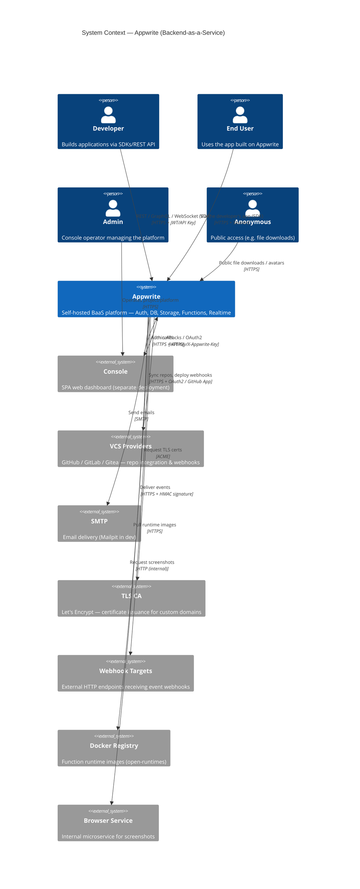

# C4 Context (Level 1) — Appwrite

> Generated by the **Architect** agent on 2026-08-05.
> Confidence: 🟢 CONFIRMED (code & docs) · 🟡 INFERRED · 🔴 GAP

## Personas

| Persona | Interaction | Auth |
|---------|-------------|------|
| **Developer** | CRUD via SDKs (REST/GraphQL), project setup | API Key (scopes), Session (console) |
| **End User** | Auth, DB queries, file uploads through developer's app | Session (cookies/tokens), JWT (functions) |
| **Admin** | Platform health, user management via Console | API Key (root scopes), Admin auth |
| **Anonymous** | Public file downloads, avatars, pixel tracking | `public` scope, Resource Tokens |

## External systems

| System | Protocol | Purpose |
|--------|----------|---------|
| **Console** | HTTPS + `X-Appwrite-Key` | Admin dashboard (separate deployment, shares platform DB) |
| **VCS Providers** | HTTPS + OAuth2 | GitHub/GitLab/Gitea repo sync, webhook-driven deploys |
| **SMTP** | SMTP | Transactional + marketing emails |
| **TLS CA** | ACME | Domain certificate issuance for custom proxy rules |
| **Webhook Targets** | HTTPS + HMAC | Event delivery to user-configured endpoints |
| **Docker Registry** | HTTPS | Function runtime image pulls |
| **Browser Service** | HTTP (internal) | Screenshots of deployed sites |
