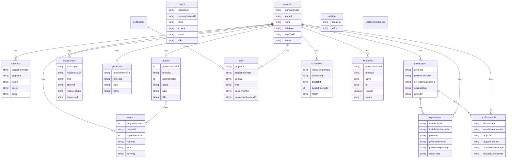

# ERD — Appwrite (Data Master pass)

> Generated by the **Data Master** on 2026-08-05. Two logical planes; only key attributes shown per entity for legibility.
> Relationships are application-side (see `relationships.md`); crow's-foot here reflects the inferred FK direction.

## Platform plane (`dbForPlatform`)

## Project plane (`dbForProject`)

```mermaid
erDiagram
    attributes {
        string databaseInternalId
        string databaseId
        string collectionInternalId
        string collectionId
        string type
        string status
    }
    authenticators {
        string userInternalId
        string userId
        string type
    }
    buckets {
        boolean enabled
        string name
        integer maximumFileSize
        string allowedFileExtensions
        string compression
        boolean encryption
    }
    cache {
    }
    challenges {
        string userInternalId
        string userId
        string type
    }
    databases {
        string name
        boolean enabled
        string originalId
        string type
        string status
    }
    deployments {
        string resourceInternalId
        string resourceId
        string type
        string installationId
        string installationInternalId
        string providerRepositoryId
    }
    files {
        string bucketId
        string bucketInternalId
        string name
    }
    functions {
        string name
        boolean enabled
        boolean live
        string installationId
        string installationInternalId
        string providerRepositoryId
    }
    identities {
        string userInternalId
        string userId
    }
    indexes {
        string databaseInternalId
        string databaseId
        string collectionInternalId
        string collectionId
        string type
        string status
    }
    memberships {
        string userInternalId
        string userId
        string teamInternalId
        string teamId
        string secret
    }
    messages {
        string providerType
        string status
        string data
        string scheduleInternalId
        string scheduleId
    }
    migrations {
        string status
        string stage
        string source
        string resources
        string statusCounters
        string resourceData
    }
    presenceLogs {
        id userInternalId
        string userId
        string status
        string source
    }
    providers {
        string name
        string provider
        string type
        boolean enabled
        string credentials
    }
    resourceTokens {
        string resourceId
        string resourceInternalId
        string resourceType
        string secret
    }
    sessions {
        string userInternalId
        string userId
        string secret
        datetime expire
    }
    sites {
        string name
        boolean enabled
        boolean live
        string installationId
        string installationInternalId
        string providerRepositoryId
    }
    stats {
        string metric
        string region
        integer value
        string period
    }
    subscribers {
        string targetId
        string targetInternalId
        string userId
        string userInternalId
        string topicId
        string topicInternalId
    }
    targets {
        string userId
        string userInternalId
        string sessionId
        string sessionInternalId
        string providerType
        string providerId
    }
    teams {
        string name
    }
    tokens {
        string userInternalId
        string userId
        integer type
        string secret
    }
    topics {
        string name
    }
    transactionLogs {
        string transactionInternalId
        string databaseInternalId
        string collectionInternalId
        string documentId
        string action
        string data
    }
    transactions {
        string status
        integer operations
        datetime expiresAt
    }
    users {
        string name
        boolean status
    }
    variables {
        string resourceType
        string resourceInternalId
        string resourceId
        string value
        boolean secret
    }
    buckets ||--o{ files : has
    databases ||--o{ attributes : has
    databases ||--o{ indexes : has
    databases ||--o{ transactionLogs : has
    deployments ||--o{ functions : has
    deployments ||--o{ sites : has
    providers ||--o{ targets : has
    sessions ||--o{ targets : has
    targets ||--o{ subscribers : has
    teams ||--o{ memberships : has
    topics ||--o{ subscribers : has
    transactions ||--o{ transactionLogs : has
    users ||--o{ authenticators : has
    users ||--o{ challenges : has
    users ||--o{ identities : has
    users ||--o{ memberships : has
    users ||--o{ presenceLogs : has
    users ||--o{ sessions : has
    users ||--o{ subscribers : has
    users ||--o{ targets : has
    users ||--o{ tokens : has
```

