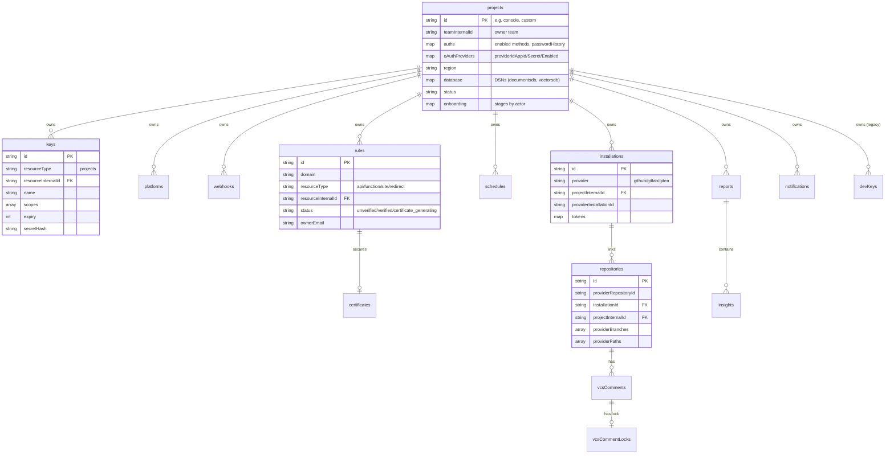
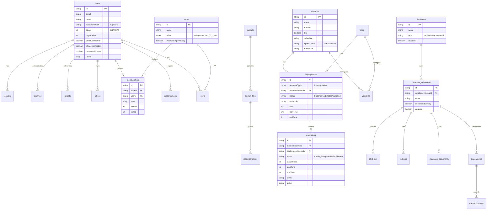

# ERD Complete — Appwrite

> Generated by the **Architect** agent on 2026-08-05.
> Source: `data-dictionary.md` (Archaeologist). Full schema detail deferred to Data Master agent.
> Confidence: 🟢 CONFIRMED (collections + relationships) · 🟡 INFERRED (field types)

## Platform schema (`dbForPlatform`)

## Project data schema (`dbForProject`)

