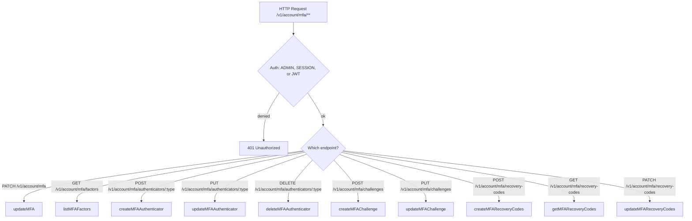
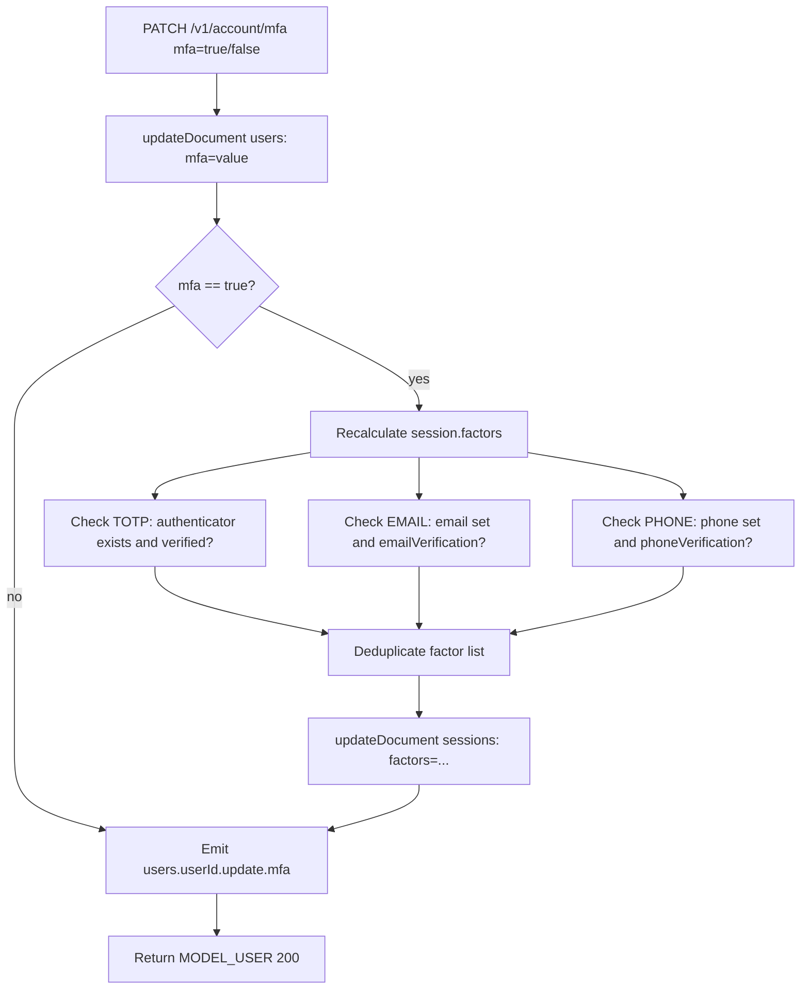
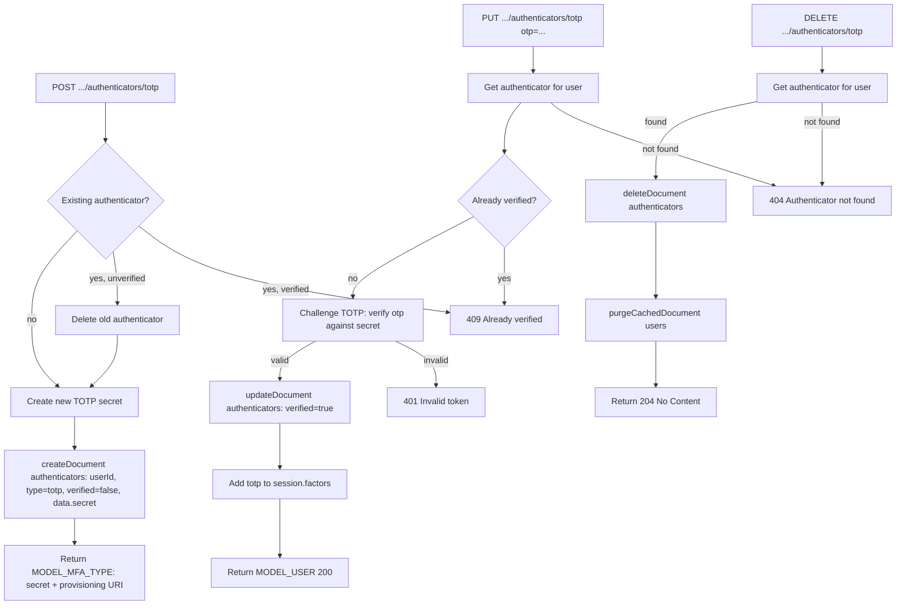
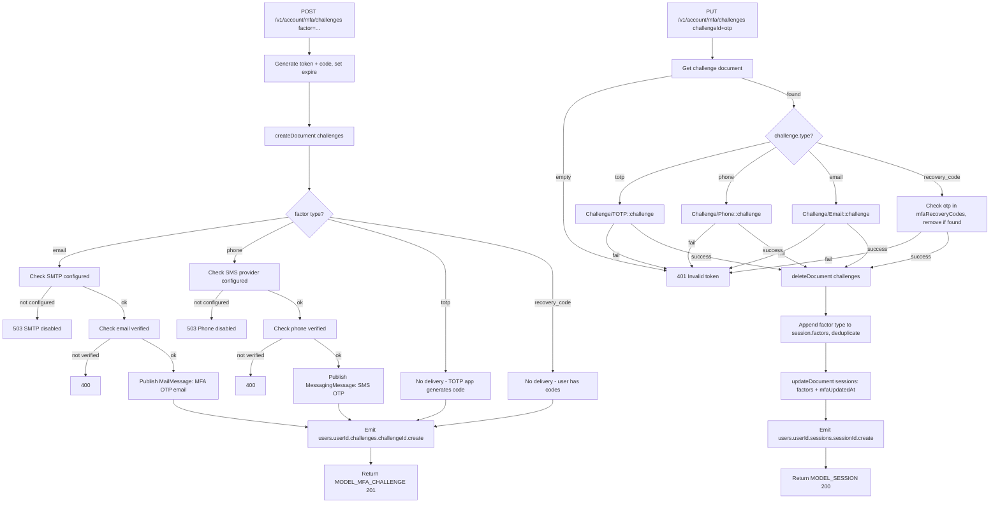
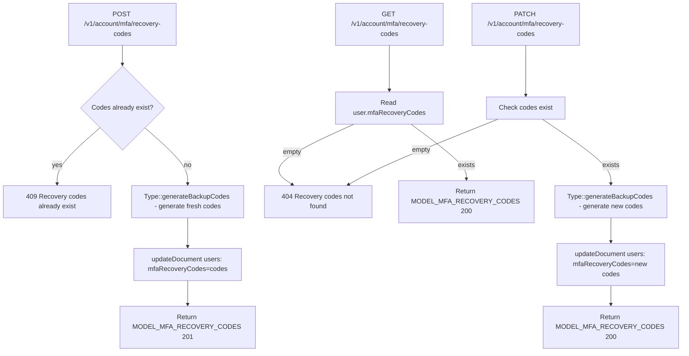

# Account (MFA) — Flow Diagram

> Generated by Reversa Archaeologist · 2026-08-04

## Main request flow

## Sub-flows (key operations)

### 1. Enable/Disable MFA (updateMFA)

### 2. TOTP Authenticator lifecycle

### 3. MFA Challenge flow

### 4. Recovery Codes lifecycle

