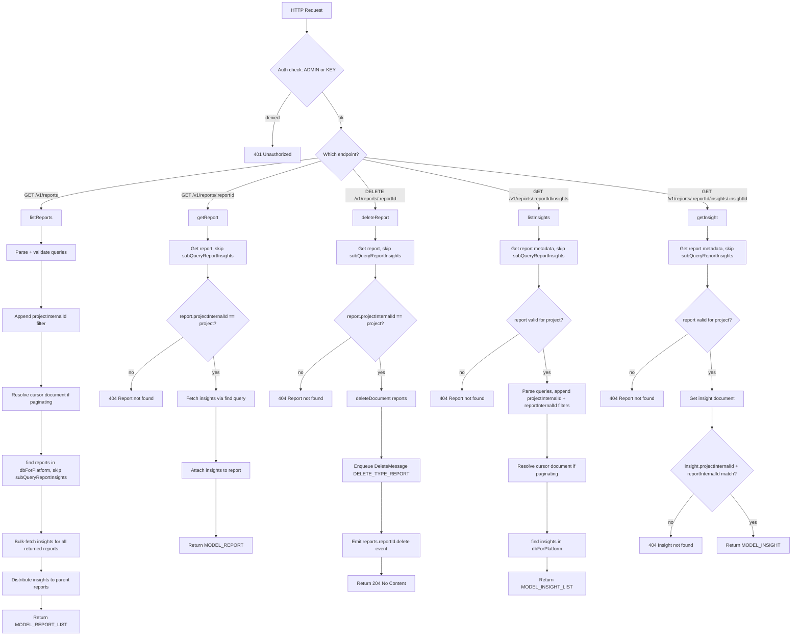
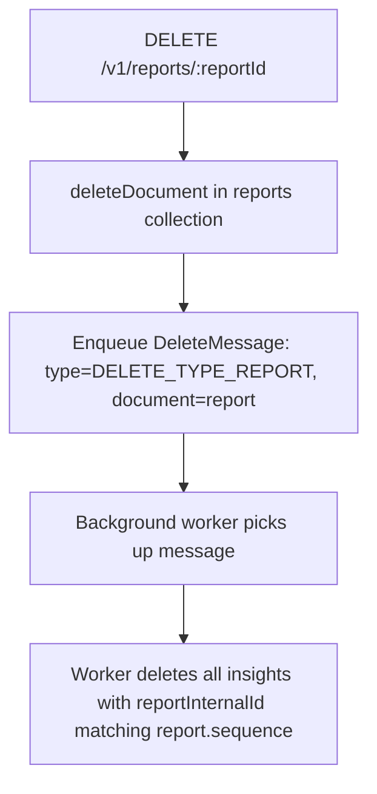
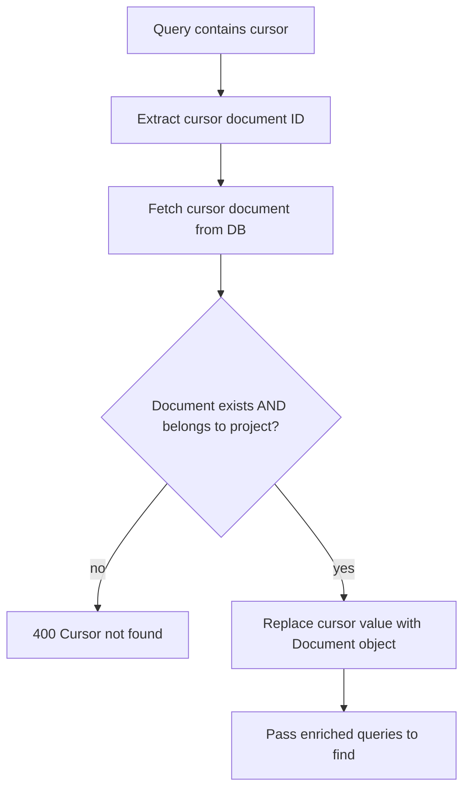

# Advisor — Flow Diagram

> Generated by Reversa Archaeologist · 2026-08-04

## Main request flow

## Sub-flows (key operations)

### 1. Project scoping enforcement

Every query appends `Query::equal('projectInternalId', [$project->getSequence()])` — the integer sequence (not the string ID) — before hitting `dbForPlatform`. This prevents cross-project data leakage.

### 2. Async report deletion

### 3. Cursor pagination (listReports / listInsights)

