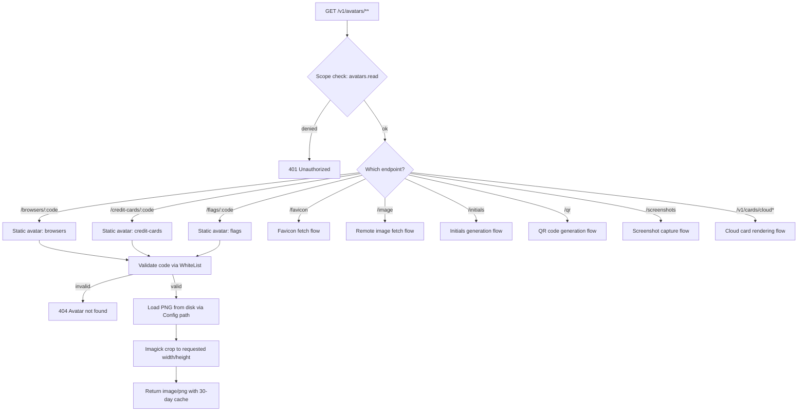
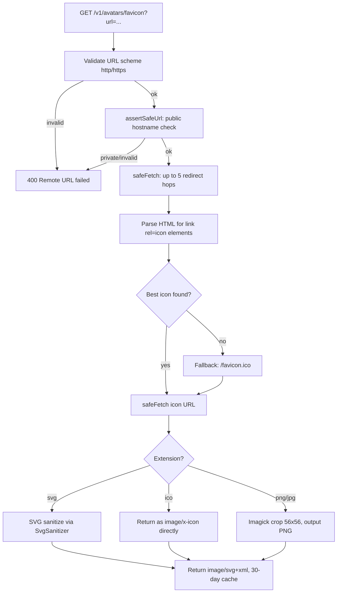
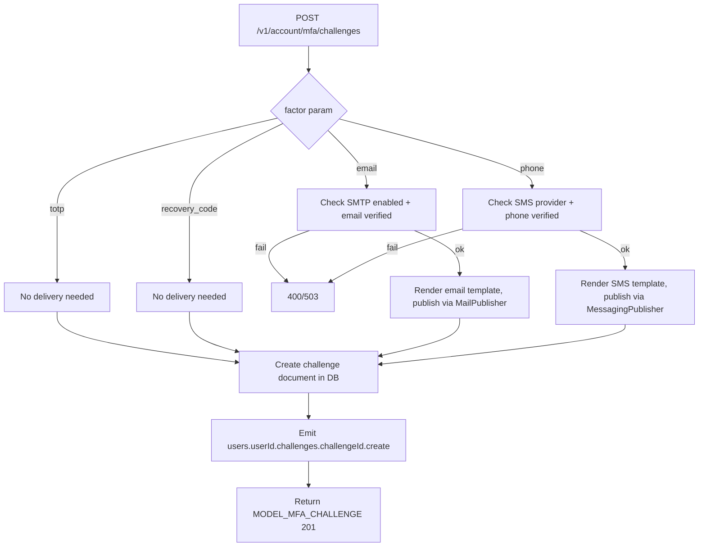
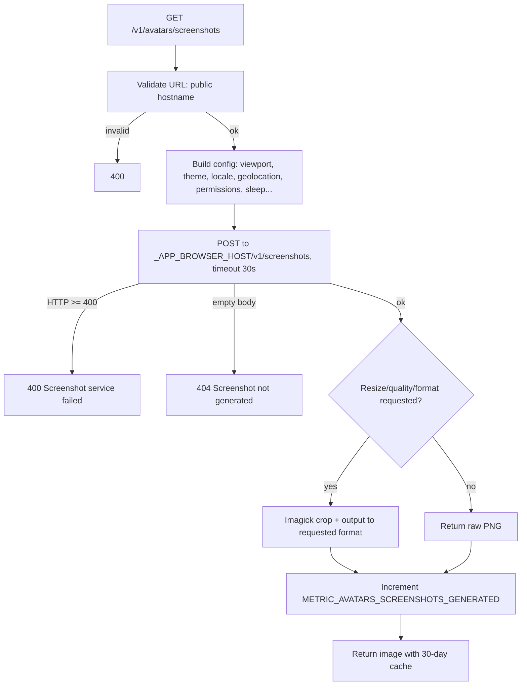
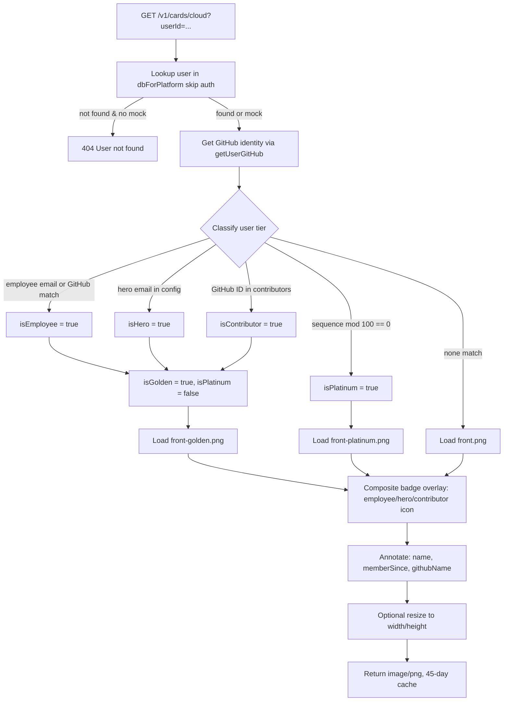

# Avatars — Flow Diagram

> Generated by Reversa Archaeologist · 2026-08-04

## Main request flow

## Sub-flows (key operations)

### 1. Favicon fetch

### 2. MFA Challenge create (Account module cross-reference)

### 3. Screenshot capture

### 4. Cloud Card rendering

