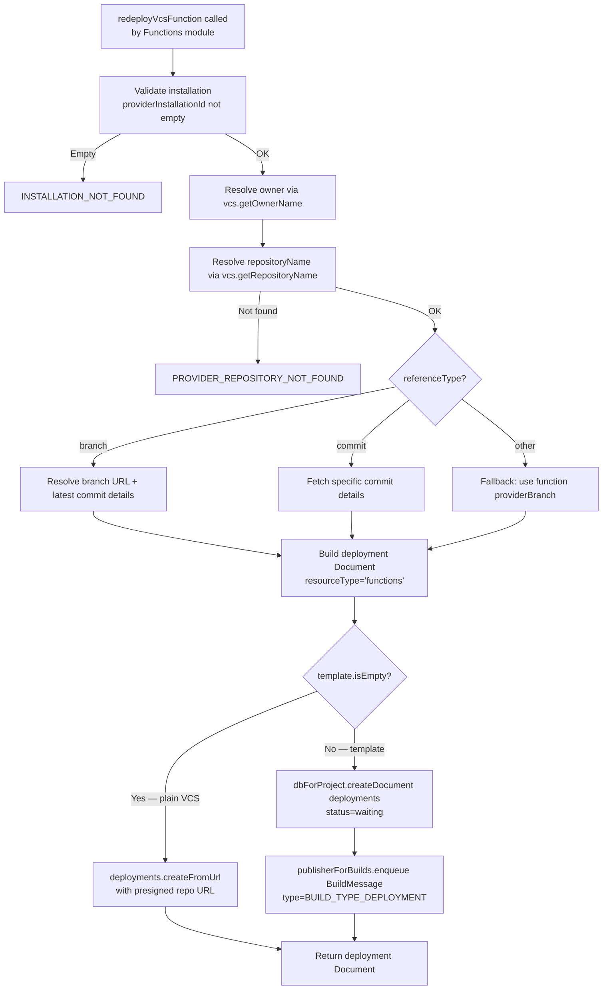

# Compute — Flow Diagram

> Generated by Reversa Archaeologist · 2026-08-04

## Overview

The Compute module has no HTTP endpoints. It is a shared base used internally by the Functions and Sites modules. The diagrams below document its two primary reusable operations.

## Sub-flows (key operations)

### redeployVcsFunction



### redeployVcsSite

```mermaid
flowchart TD
    A[redeployVcsSite called\nby Sites module] --> B[Validate installation + resolve owner/repo]
    B --> C[Build deployment Document\nresourceType='sites'\nbuildCommands=install+build\nbuildOutput=outputDirectory]
    C --> D[dbForProject.createDocument deployments]
    D --> E[Mint unique deployment domain\nID.unique + sitesDomain]
    E --> F[Create rules doc for deployment domain\nstatus=verified, trigger=deployment]
    F --> G{commitHash present?}
    G -->|Yes| H[Mint commit-hash domain\ncommit-{hash16}.{sitesDomain}]
    H --> I[Create rules doc for commit domain\nDuplicate exception ignored]
    G -->|No| I
    I --> J{providerBranch present?}
    J -->|Yes| K[BranchDomainFilter.apply\nmint branch-preview domain]
    K --> L[Create rules doc for branch-preview\nDuplicate exception ignored]
    J -->|No| L
    L --> M[updateEmptyManualRule\nbackfill manual rules with empty deploymentId]
    M --> N{template.isEmpty?}
    N -->|Yes — plain VCS| O[deployments.createFromUrl\nwith presigned repo URL]
    N -->|No — template| P[publisherForBuilds.enqueue BuildMessage]
    O --> Q[Return deployment Document]
    P --> Q
```
