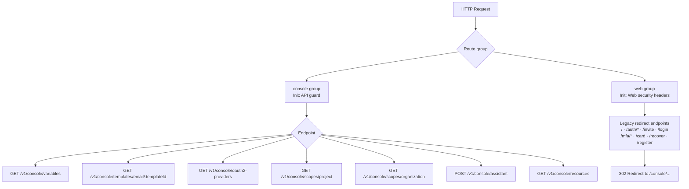
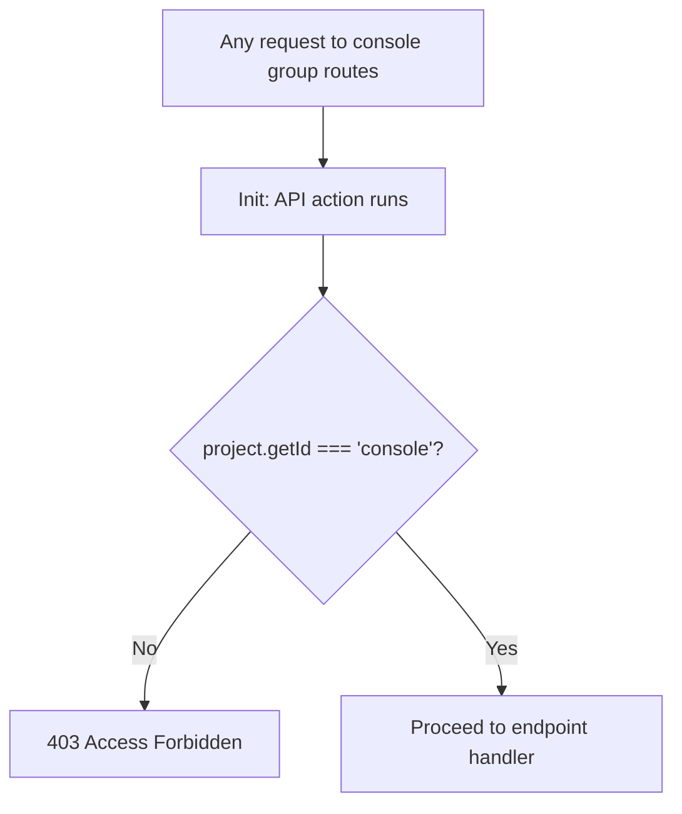
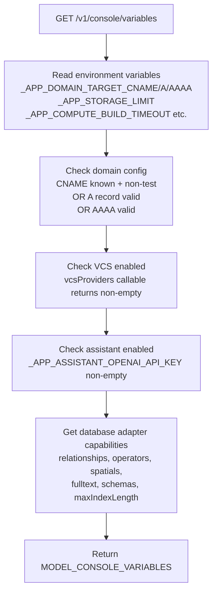
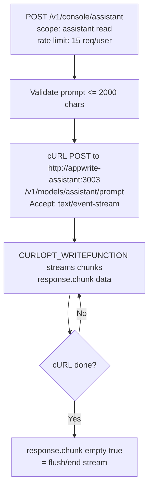
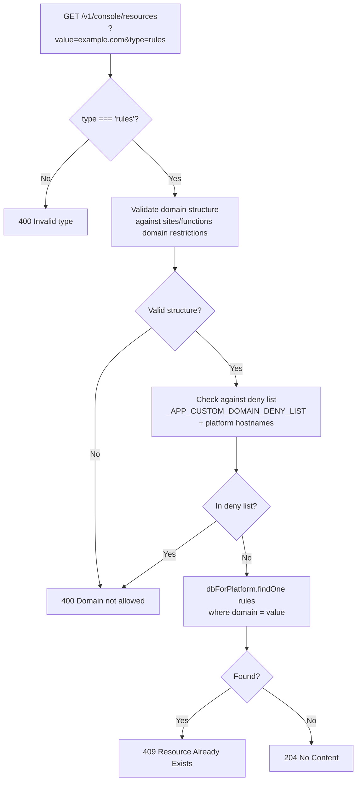

# Console — Flow Diagram

> Generated by Reversa Archaeologist · 2026-08-04

## Main request flow

## Sub-flows

### 1. Console API group guard

### 2. getVariables — server configuration

### 3. AI assistant proxy (streaming)

### 4. Resource availability check

