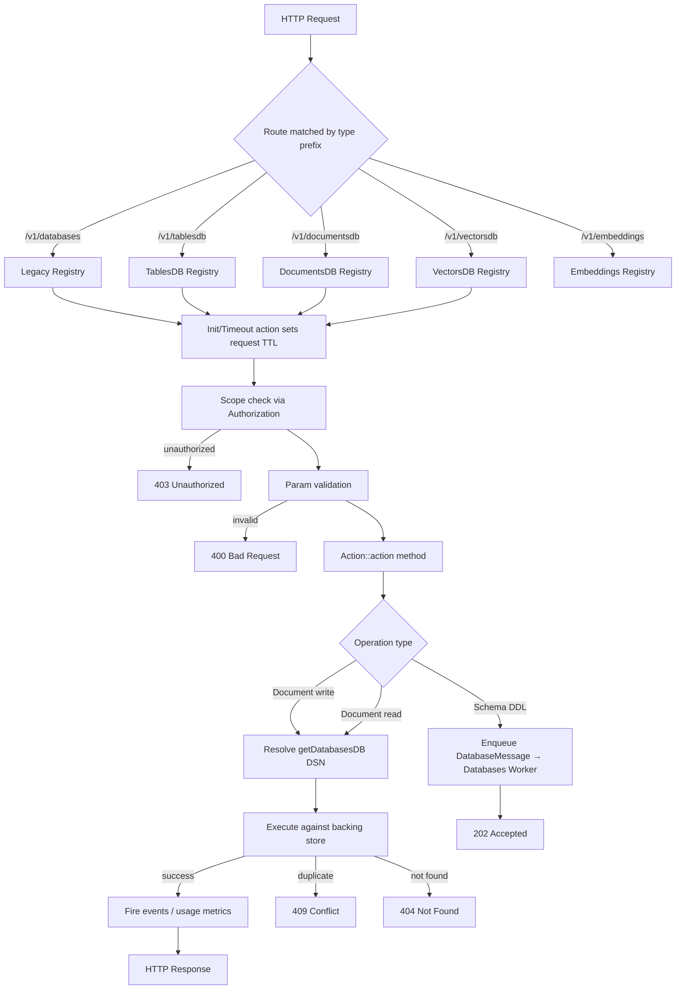
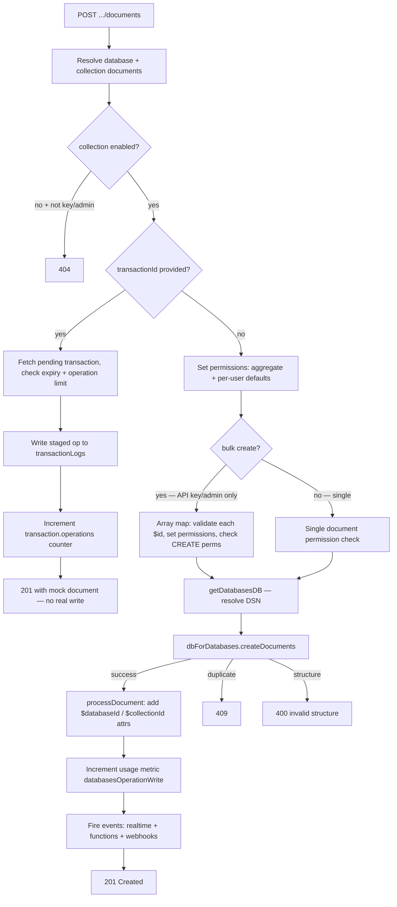
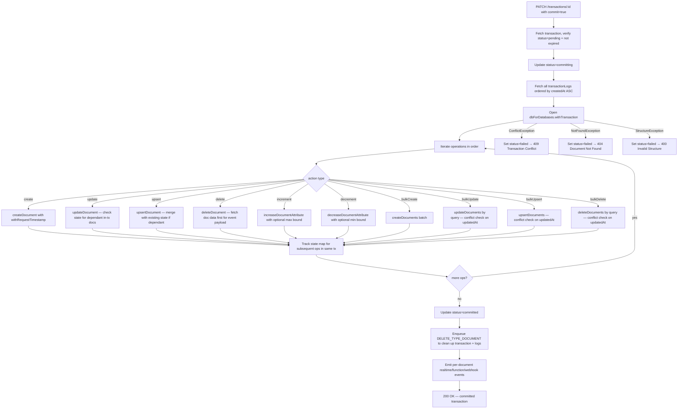
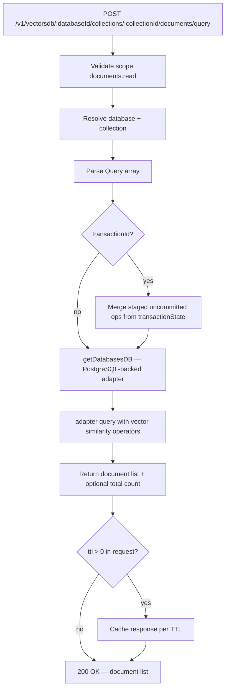

# Databases — Flow Diagram

> Generated by Reversa Archaeologist · 2026-08-04

## Main request flow



## Sub-flow 1: Create Attribute (async DDL)

```mermaid
flowchart TD
    A[POST .../attributes/string] --> B[Validate databaseId + collectionId]
    B --> C{DB type mismatch?}
    C -->|yes| ERR[404 Not Found]
    C -->|no| D[Write attribute doc with status=processing to metadata DB]
    D --> E[Enqueue DatabaseMessage type=CREATE_ATTRIBUTE]
    E --> F[202 Accepted — attribute returned with status=processing]

    subgraph Worker: Databases
        W1[Receive DatabaseMessage] --> W2{type?}
        W2 -->|CREATE_ATTRIBUTE| W3[Re-fetch attribute doc from metadata DB]
        W3 -->|VAR_RELATIONSHIP| W4[dbForDatabases.createRelationship]
        W3 -->|other| W5[dbForDatabases.createAttribute]
        W4 & W5 -->|success| W6[Update status=available]
        W4 & W5 -->|failure| W7[Update status=failed + store error]
        W6 & W7 --> W8[Purge cached collection document]
        W8 --> W9[Trigger realtime event .attributes.[id].update]
    end
```

## Sub-flow 2: Create Document (with optional transaction staging)



## Sub-flow 3: Transaction commit



## Sub-flow 4: Vector search query (VectorsDB only)


