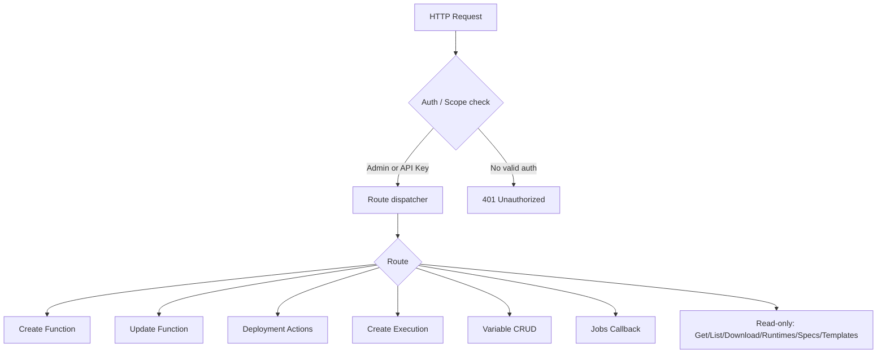
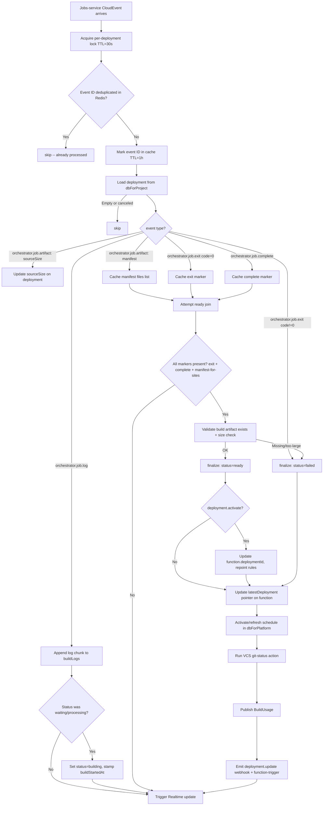

# Functions — Flow Diagram

> Generated by Reversa Archaeologist · 2026-08-04

## Main request flow



## Sub-flow: Create Function

```mermaid
flowchart TD
    A[POST /v1/functions] --> B[Abuse rate-limit check per project per day]
    B -- Exceeded --> ERR1[GENERAL_RATE_LIMIT_EXCEEDED]
    B -- OK --> C{VCS: installationId provided?}

    C -- Yes --> D[Load installation from dbForPlatform]
    D -- Not found or wrong project --> ERR2[INSTALLATION_NOT_FOUND]
    D -- OK --> E
    C -- No --> E

    E{providerRepositoryId without installationId+branch?} -- Yes --> ERR3[GENERAL_ARGUMENT_INVALID]
    E -- No --> F[createDocument in functions collection]
    F -- Duplicate ID --> ERR4[FUNCTION_ALREADY_EXISTS]
    F -- OK --> G[Create schedule document in dbForPlatform -- active=false]

    G --> H{VCS connected?}
    H -- Yes --> I[createDocument in repositories -- dbForPlatform]
    I --> J{VCS provider supports installation-scope webhooks?}
    J -- No --> K[repositoryWebhooks.ensure: register repo webhook]
    J -- Yes --> L
    K --> L

    L[updateDocument functions: set scheduleId + repositoryId] --> M{Legacy format request v < 1.7.0?}
    M -- Yes with template --> N[Deploy from template via Deployments service]
    M -- Yes with VCS --> O[redeployVcsFunction]
    M -- No --> P
    N --> P
    O --> P

    P[Emit functions.[functionId].create] --> RESP[201 Created: MODEL_FUNCTION]
```

## Sub-flow: Code Deployment Upload (chunked)

```mermaid
flowchart TD
    A[POST /v1/functions/:functionId/deployments] --> B[Validate function exists]
    B -- Not found --> ERR1[FUNCTION_NOT_FOUND]
    B --> C[Validate entrypoint is set]
    C -- Missing --> ERR2[FUNCTION_ENTRYPOINT_MISSING]
    C --> D[Validate file: .gz extension + size <= plan limit]
    D -- Invalid --> ERR3[STORAGE_FILE_TYPE_UNSUPPORTED / INVALID_FILE_SIZE]
    D --> E[Parse content-range header: compute chunk + chunks]

    E --> F[Acquire per-deployment distributed lock]
    F -- Contention --> RETRY[503 with Retry-After: 5]

    F --> G{Existing deployment doc?}
    G -- Already complete --> RESP1[202 Accepted -- idempotent]
    G -- New or partial --> H[deviceForFunctions.prepare / upload chunk]

    H --> I{All chunks uploaded?}
    I -- No --> J[Update sourceChunksUploaded in deployments doc]
    J --> RESP2[202 Accepted: partial]
    I -- Yes --> K[deviceForFunctions.finalize]
    K --> L[deployments.createFromUpload]
    L --> M[Emit functions.[functionId].deployments.[deploymentId].create]
    M --> RESP3[202 Accepted: MODEL_DEPLOYMENT status=waiting]
```

## Sub-flow: Jobs Worker (build callbacks)


