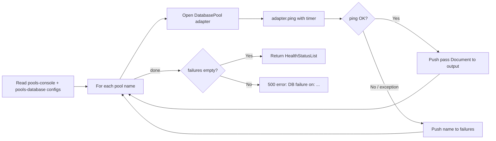
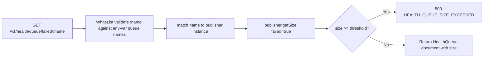
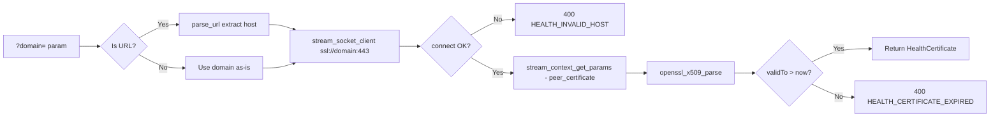

# Health — Flow Diagram

> Generated by Reversa Archaeologist · 2026-08-04

## Main request flow

```mermaid
flowchart TD
    A[GET /v1/health/**] --> B[Scope check: health.read or public or root]
    B --> C{Which endpoint?}

    C -->|/v1/health| D[Return HTTP pass status immediately]
    C -->|/v1/health/version| E[Return APP_VERSION_STABLE constant]
    C -->|/v1/health/db| F[DB Pool Check]
    C -->|/v1/health/cache| G[Cache Ping Check]
    C -->|/v1/health/pubsub| H[PubSub Pool Check]
    C -->|/v1/health/time| I[NTP Time Check]
    C -->|/v1/health/certificate| J[TLS Certificate Check]
    C -->|/v1/health/storage| K[Storage Device Check]
    C -->|/v1/health/storage/local| L[Local Volume Check]
    C -->|/v1/health/anti-virus| M[ClamAV Check]
    C -->|/v1/health/geo| N[Geo Service HTTP Probe]
    C -->|/v1/health/stats| O[Stats: storage + Redis INFO]
    C -->|/v1/health/queue/**| P[Queue Size Check]
    C -->|/v1/health/queue/failed/:name| Q[Failed Jobs Count Check]

    D --> Z[200 OK: HealthStatus document]
    E --> Z

    F --> F1{All pools ping?}
    F1 -->|Yes| F2[Return HealthStatusList]
    F1 -->|No: any failure| F3[500 GENERAL_SERVER_ERROR]

    G --> G1{Cache ping?}
    G1 -->|Yes| G2[Return HealthStatusList]
    G1 -->|No| G3[500 GENERAL_SERVER_ERROR]

    H --> H1{All PubSub pools ping?}
    H1 -->|Yes| H2[Return HealthStatusList]
    H1 -->|No| H3[500 GENERAL_SERVER_ERROR]

    I --> I1[UDP socket to time.google.com:123]
    I1 --> I2[Parse NTP timestamp]
    I2 --> I3{|drift| <= 60s?}
    I3 -->|Yes| I4[Return HealthTime document]
    I3 -->|No| I5[500 Server time gaps detected]

    J --> J1[SSL stream_socket_client :443]
    J1 --> J2[openssl_x509_parse peer cert]
    J2 --> J3{validTo > now?}
    J3 -->|Yes| J4[Return HealthCertificate document]
    J3 -->|Expired| J5[400 HEALTH_CERTIFICATE_EXPIRED]
    J1 -->|Connect fail| J6[400 HEALTH_INVALID_HOST]

    K --> K1[For each device: write test file]
    K1 --> K2[Read back and assert content]
    K2 --> K3[Delete test file]
    K3 --> K4[Return HealthStatus pass]

    M --> M1{_APP_STORAGE_ANTIVIRUS == disabled?}
    M1 -->|Yes| M2[Return status=disabled]
    M1 -->|No| M3[Ping ClamAV via TCP]
    M3 --> M4[Return HealthAntivirus with version]

    P --> P1[Get queue size via publisher.getSize]
    P1 --> P2{size >= threshold?}
    P2 -->|Yes| P3[500 HEALTH_QUEUE_SIZE_EXCEEDED]
    P2 -->|No| P4[Return HealthQueue size document]

    Q --> Q1[Match :name to publisher via match statement]
    Q1 --> Q2[publisher.getSize failed=true]
    Q2 --> P2
```

## Sub-flows: key operations

### 1. Database pool health check (getDB)

Iterates two configuration keys: `pools-console` (Console DB pools) and `pools-database` (Project DB pools). For each pool name it opens a `DatabasePool` adapter and calls `ping()`. All failures are collected; if any exist an error is raised listing all failed pool names.



### 2. Queue failed-job check (getFailedJobs)

A single endpoint handles every queue by routing the queue `:name` path parameter through a `match` expression to the appropriate publisher, then calling `getSize(failed: true)`.



### 3. TLS certificate check (getCertificate)

Accepts a domain name or full URL. If a URL is passed, `parse_url` extracts the host. Then an SSL stream socket is opened to port 443, the peer certificate is captured via stream context, and `openssl_x509_parse` extracts validity dates.


