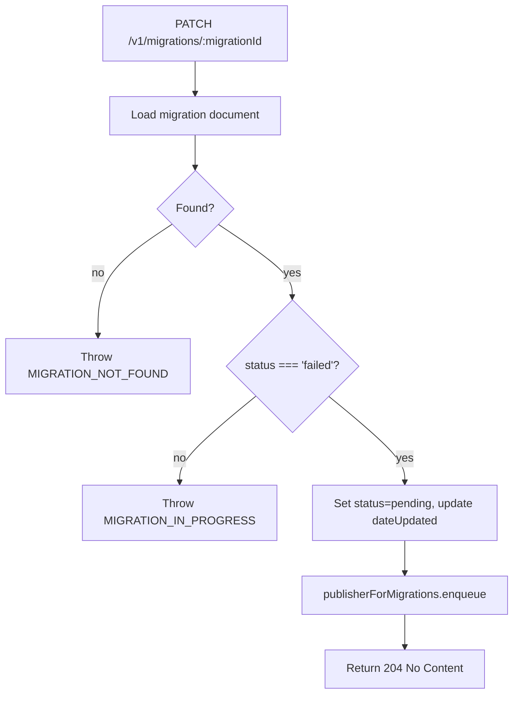
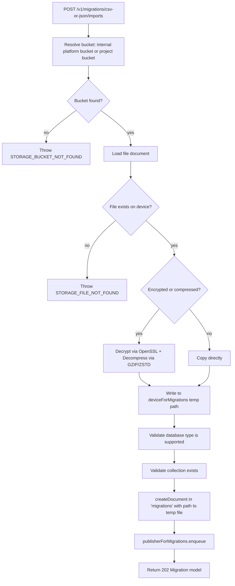

# Migrations — Flow Diagram

> Generated by Reversa Archaeologist · 2026-08-04

## Main request flow

```mermaid
flowchart TD
    A[HTTP Request admin only] --> B{Endpoint}
    B -->|GET /v1/migrations| C[listMigrations]
    B -->|GET /v1/migrations/:id| D[getMigration]
    B -->|PATCH /v1/migrations/:id| E[retryMigration]
    B -->|DELETE /v1/migrations/:id| F[deleteMigration]
    B -->|POST /v1/migrations/{provider}| G[createXxxMigration]
    B -->|GET /v1/migrations/{provider}/report| H[getXxxReport]
    B -->|POST /v1/migrations/csv/exports| I[createCSVExport]
    B -->|POST /v1/migrations/csv/imports| J[createCSVImport]
    B -->|POST /v1/migrations/json/exports| K[createJSONExport]
    B -->|POST /v1/migrations/json/imports| L[createJSONImport]
```

## Sub-flow 1: Create provider migration (Appwrite, Firebase, Supabase, NHost)

```mermaid
flowchart TD
    A[POST /v1/migrations/{provider}] --> B[Validate provider credentials]
    B --> C{Firebase?}
    C -->|yes| D[Parse + validate service account JSON]
    C -->|no| E[Use URL + key or DB credentials]
    D --> F[createDocument in 'migrations' with status=pending]
    E --> F
    F --> G[Queue migrations event]
    G --> H[publisherForMigrations.enqueue with project + platform context]
    H --> I[Return 202 Migration model]
    I --> J[Worker picks up and processes asynchronously]
```

## Sub-flow 2: Get provider report (dry run)

```mermaid
flowchart TD
    A[GET /v1/migrations/{provider}/report] --> B[Validate provider credentials]
    B --> C[Instantiate provider source class]
    C --> D[Call source.report with resource list]
    D --> E{Connection error?}
    E -->|yes| F[Throw MIGRATION_PROVIDER_ERROR]
    E -->|no| G[Return 200 MigrationReport model]
```

## Sub-flow 3: Retry failed migration



## Sub-flow 4: CSV/JSON import


