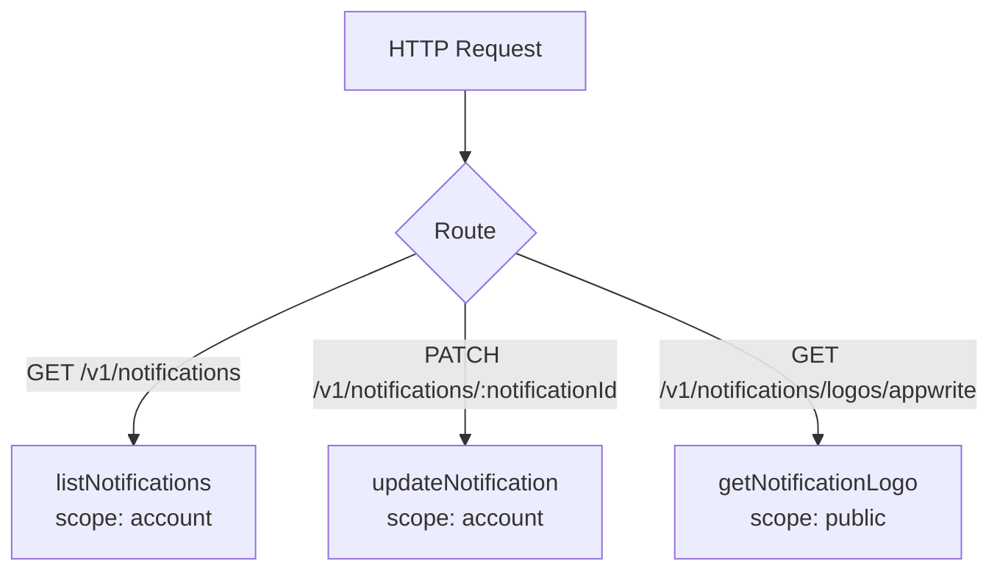
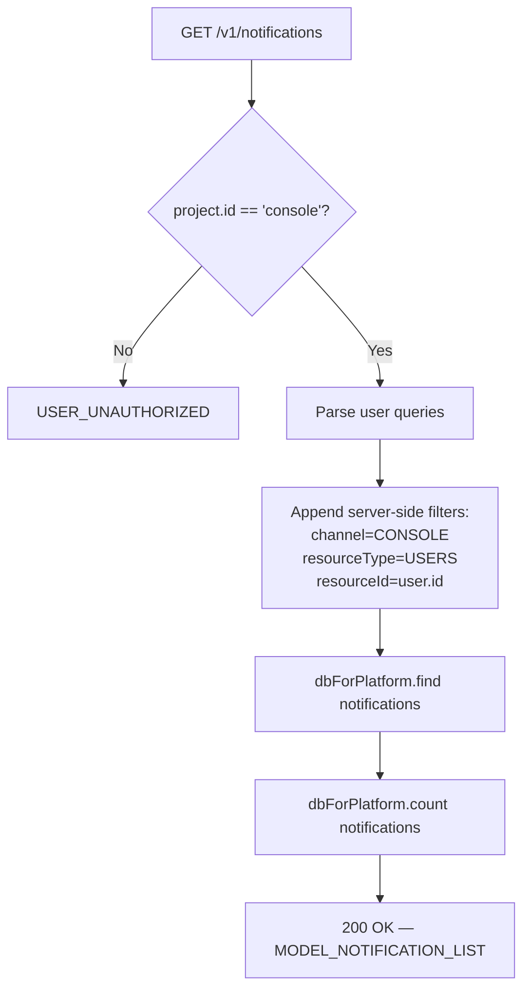
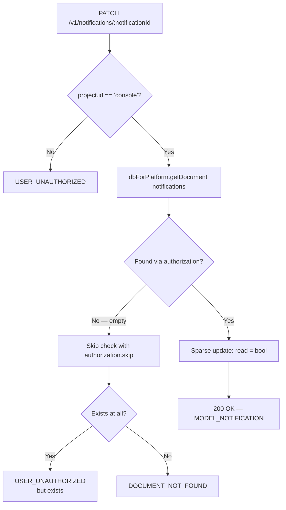
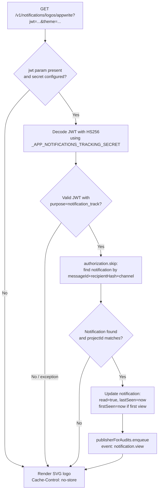

# Notifications — Flow Diagram

> Generated by Reversa Archaeologist · 2026-08-04

## Main request flow

## Sub-flows (key operations)

### List notifications

### Update notification (mark read)

### Email open tracking (logo pixel)

