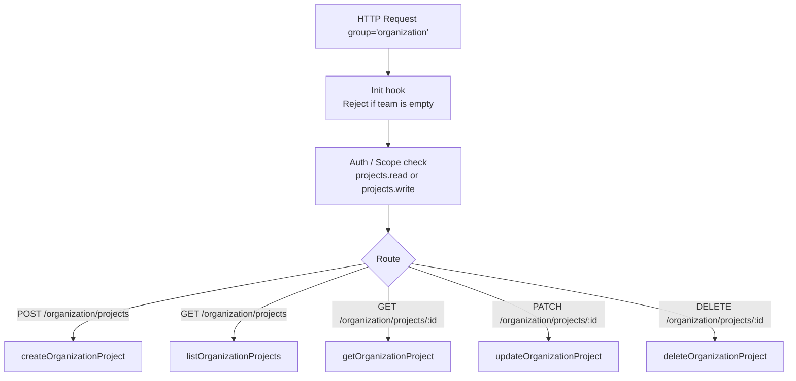
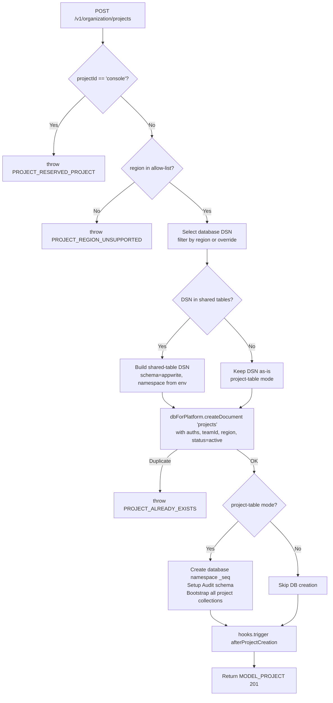
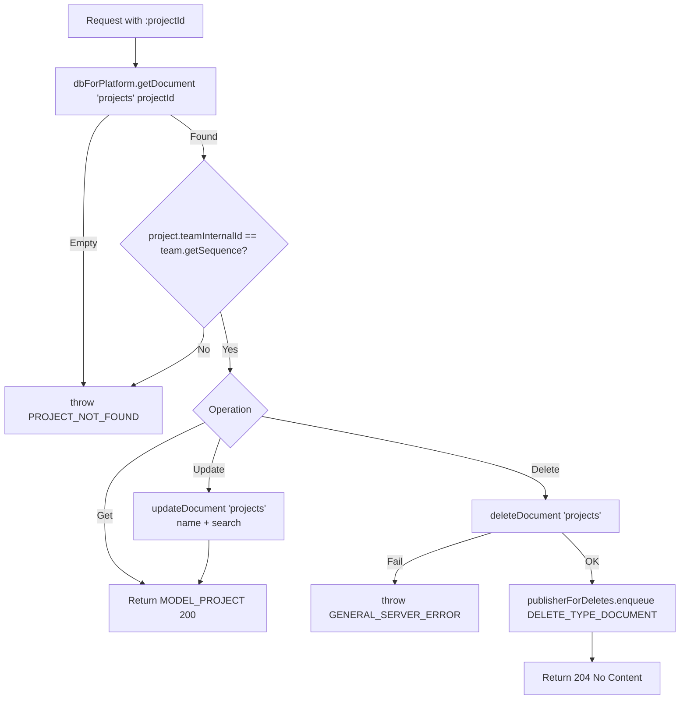

# Organization — Flow Diagram

> Generated by Reversa Archaeologist · 2026-08-04

## Main request flow



## Sub-flows (key operations)

### Project creation



### Project ownership enforcement (Get / Update / Delete)



### Project list with selective field optimisation

```mermaid
flowchart TD
    A[GET /v1/organization/projects] --> B[Parse queries\nAppend teamInternalId filter]
    B --> C{select query present?}
    C -->|No| D[dbForPlatform.find 'projects']
    C -->|Yes| E{select * ?}
    E -->|Yes| D
    E -->|No| F[Determine which sub-query filters\ncan be skipped based on unselected attrs]
    F --> G[dbForPlatform.skipFilters(...find)]
    D --> H[Apply ListSelection response filter]
    G --> H
    H --> I[Return MODEL_PROJECT_LIST 200]
```
