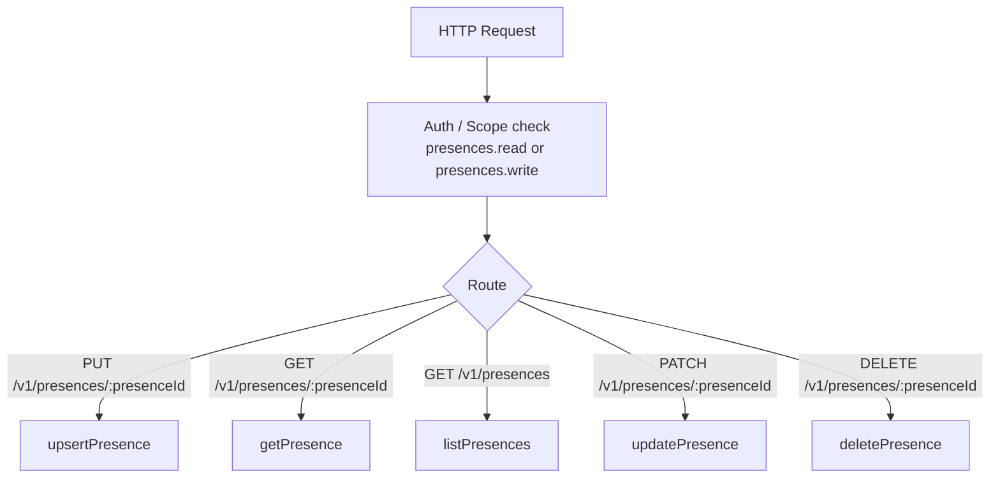
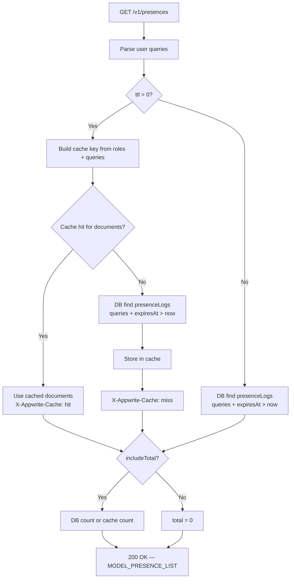

# Presences — Flow Diagram

> Generated by Reversa Archaeologist · 2026-08-04

## Main request flow



## Sub-flows (key operations)

### Upsert presence

```mermaid
flowchart TD
    A[PUT /v1/presences/:presenceId] --> B{userId provided?}
    B -->|Yes + not API key/privileged| ERR1[GENERAL_UNAUTHORIZED_SCOPE]
    B -->|API key + no userId| ERR2[GENERAL_BAD_REQUEST]
    B -->|Valid| C[Resolve userId from session or explicit param]
    C --> D{User exists in DB?}
    D -->|No| ERR3[USER_NOT_FOUND]
    D -->|Yes| E[Build presenceData\nstatus, source, expiresAt=now+15m, metadata]
    E --> F[PresenceState::setPermissions\ndefault = owner full access]
    F --> G[PresenceState::upsertForUser\ncreate or overwrite document in presenceLogs]
    G --> H{New record?}
    H -->|Yes| I[usage.addMetric METRIC_USERS_PRESENCE +1]
    H -->|No| J[Skip metric increment]
    I --> K[Emit presences.\[presenceId\].upsert event]
    J --> K
    K --> L[200 OK — MODEL_PRESENCE]
```

### List presences with TTL cache


