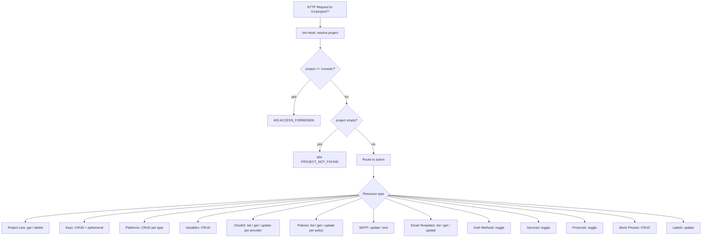
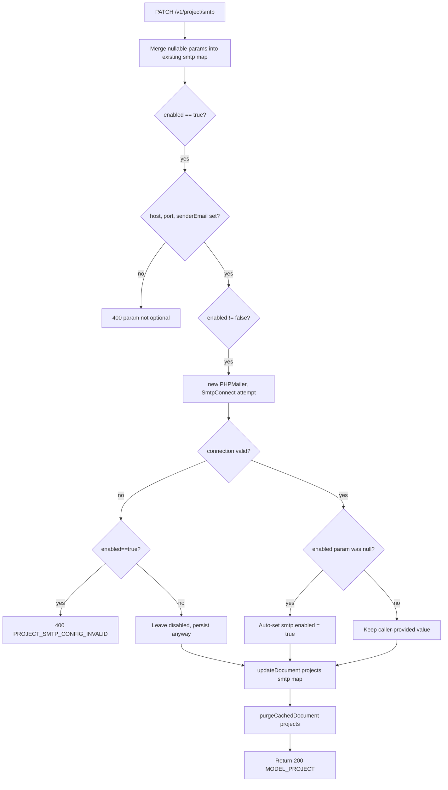
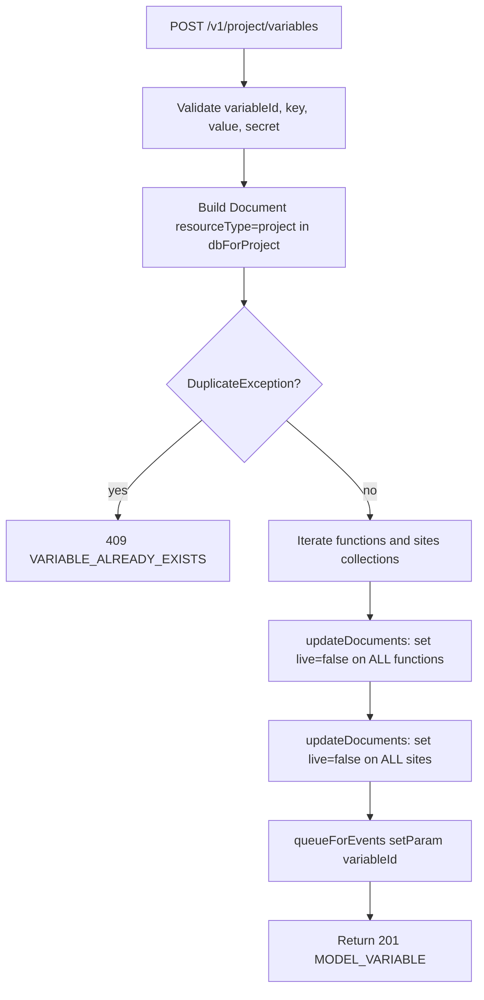

# Project — Flow Diagram

> Generated by Reversa Archaeologist · 2026-08-04

## Main request flow



## Sub-flows (key operations)

### API Key Creation

```mermaid
flowchart TD
    A[POST /v1/project/keys] --> B[Validate keyId, name, scopes, expire]
    B --> C{keyId == 'unique()'?}
    C -- yes --> D[Generate ID.unique]
    C -- no --> E[Use provided keyId]
    D & E --> F[Build Document with resourceType=projects, secret=API_KEY_STANDARD+256 random bytes]
    F --> G[authorization->skip: dbForPlatform->createDocument keys]
    G --> H{DuplicateException?}
    H -- yes --> ERR[409 KEY_ALREADY_EXISTS]
    H -- no --> I[purgeCachedDocument projects]
    I --> J[queueForEvents setParam keyId]
    J --> K[Return 201 MODEL_KEY]
```

### OAuth2 Provider Update

```mermaid
flowchart TD
    A[PATCH /v1/project/oauth2/{provider}] --> B[Resolve provider class via getProviderId]
    B --> C[Load oAuthProviders map from project]
    C --> D{clientId provided?}
    D -- yes --> E[Set {providerId}Appid]
    D -- no --> F[Keep existing]
    E & F --> G{clientSecret provided?}
    G -- yes --> H[Set {providerId}Secret]
    G -- no --> I[Keep existing]
    H & I --> J{enabled == true or null?}
    J -- yes --> K{clientId or clientSecret empty?}
    K -- yes --> ERR1[400 INVALID: credentials required]
    K -- no --> L[Instantiate provider class with credentials]
    L --> M{verifyCredentials method exists?}
    M -- yes --> N[Call verifyCredentials]
    N --> O{success?}
    O -- no --> P{enabled==true explicitly?}
    P -- yes --> ERR2[400 INVALID: could not enable]
    P -- no --> Q[Skip auto-enable]
    O -- yes --> R[Set {providerId}Enabled = true]
    J -- enabled==false --> S[Set {providerId}Enabled = false]
    R & Q & S --> T[updateDocument projects with new oAuthProviders]
    T --> U[purgeCachedDocument projects]
    U --> V[queueForEvents setParam providerId]
    V --> W[Return 200 buildReadResponse with secret cleared]
```

### SMTP Configuration Update



### Policy Read (list/get)

Policies are not stored as separate documents. They are virtual documents synthesized from the `project.auths` attribute map. `listPolicies` builds all 10 policy documents in memory. `getProjectPolicy` uses a `match` on the policyId to construct the specific document.

### Variable Create (with rebuild side-effect)


