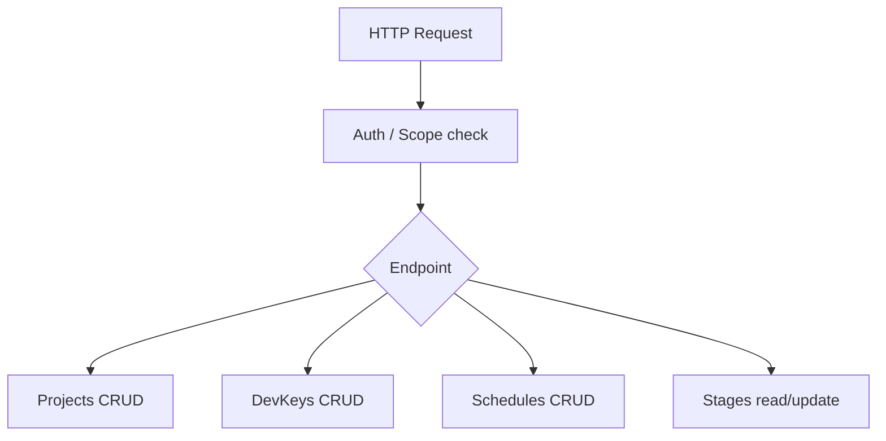
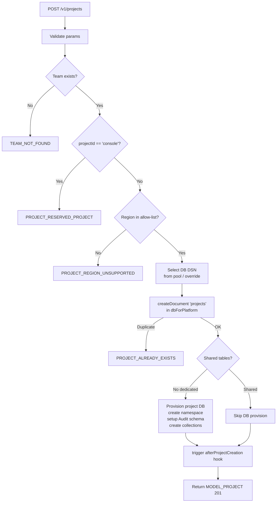
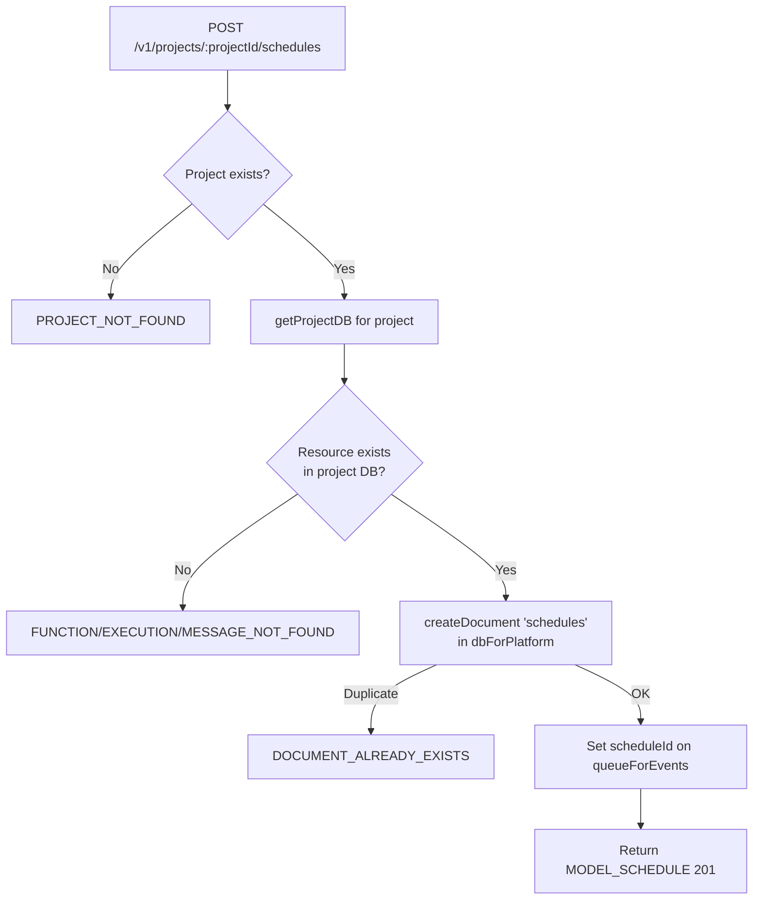
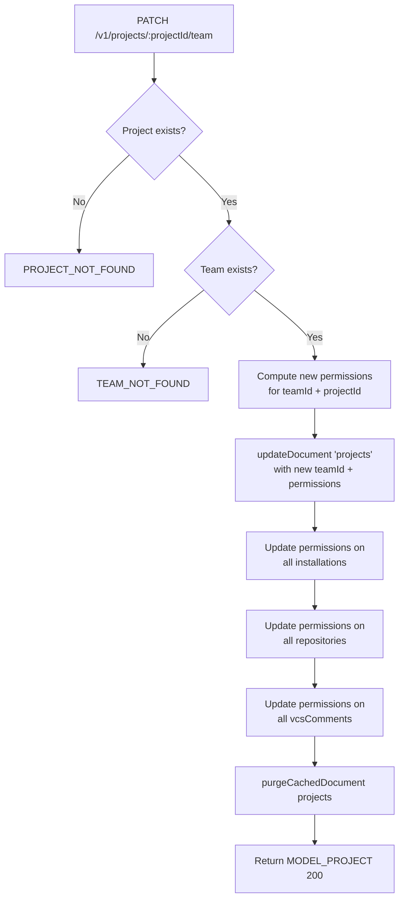

# Projects — Flow Diagram

> Generated by Reversa Archaeologist · 2026-08-04

## Main request flow

## Sub-flows (key operations)

### 1. Create Project

### 2. Create Schedule

### 3. Update Project Team (ownership transfer)

