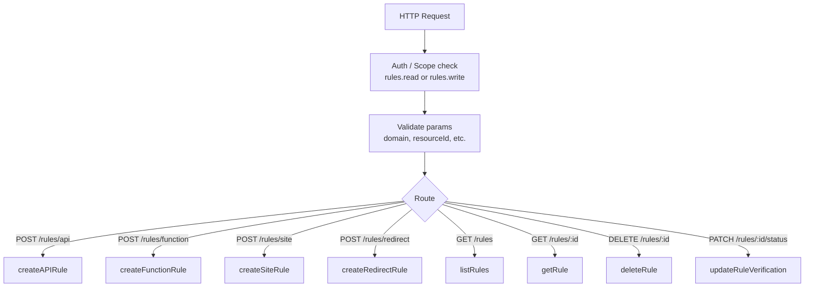
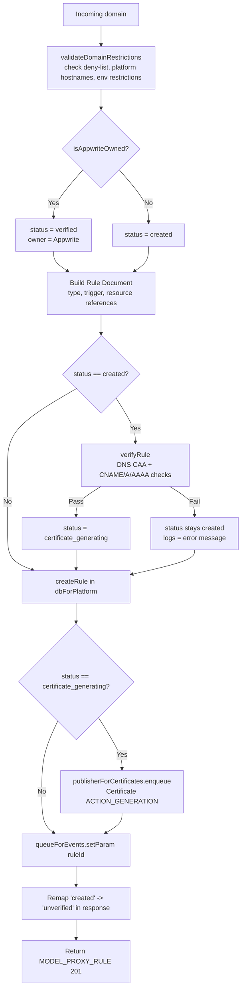
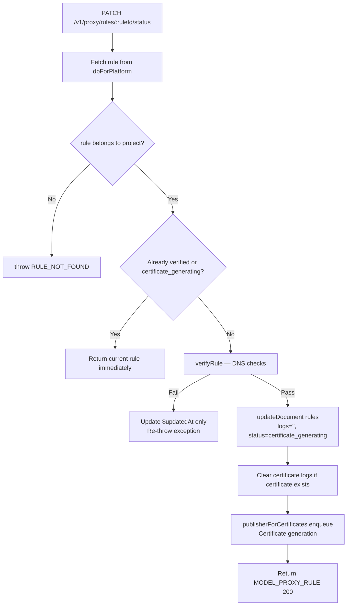
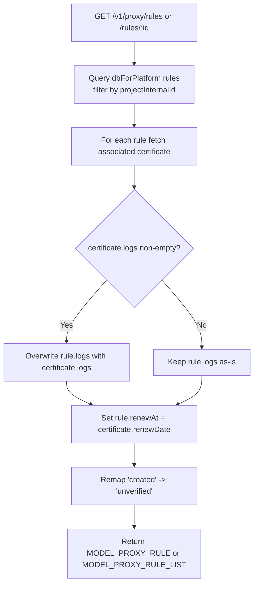

# Proxy — Flow Diagram

> Generated by Reversa Archaeologist · 2026-08-04

## Main request flow

## Sub-flows (key operations)

### Rule creation (all types share this pattern)

### Rule status update (verification retry)

### Get / List rule hydration

