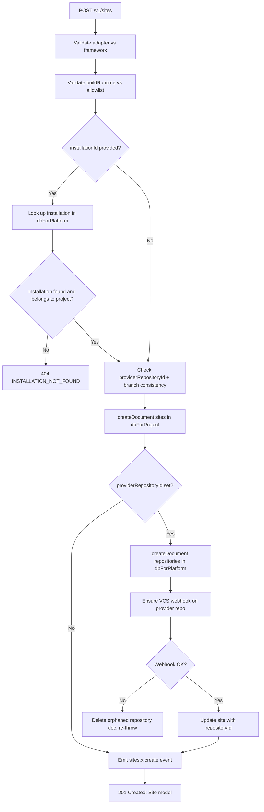
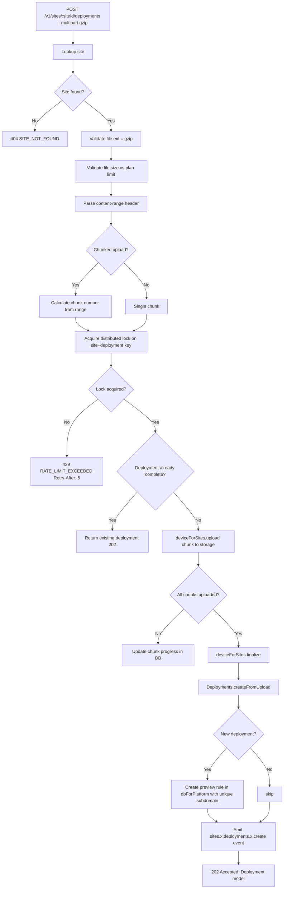
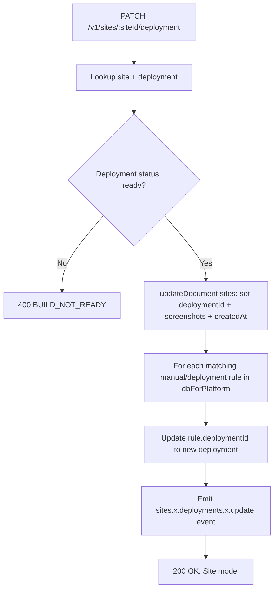
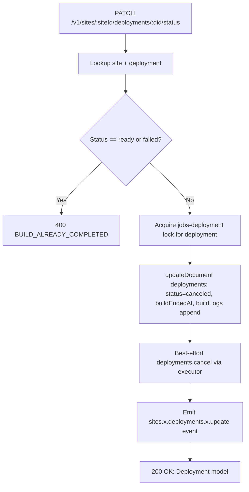
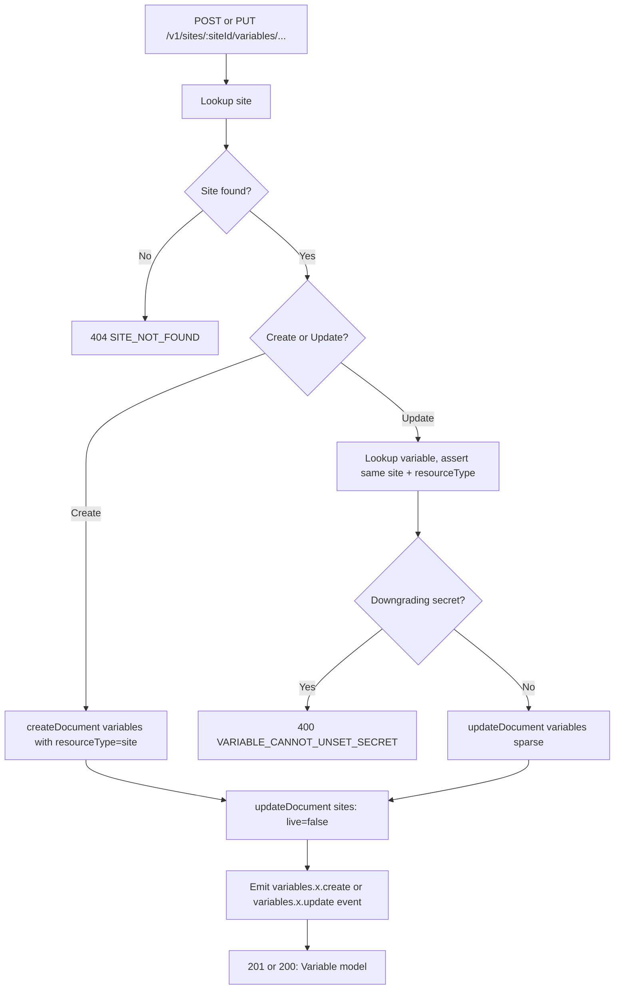

# Sites — Flow Diagram

> Generated by Reversa Archaeologist · 2026-08-04

## Main request flow

```mermaid
flowchart TD
    A[HTTP Request to /v1/sites/**] --> B[Auth + Scope check: sites.read / sites.write / public]
    B --> C{Route}

    C -->|POST /v1/sites| D[createSite]
    C -->|GET /v1/sites| E[listSites]
    C -->|GET /v1/sites/:id| F[getSite]
    C -->|PUT /v1/sites/:id| G[updateSite]
    C -->|DELETE /v1/sites/:id| H[deleteSite]
    C -->|PATCH /v1/sites/:id/deployment| I[updateSiteDeployment]
    C -->|GET /v1/sites/frameworks| J[listFrameworks]
    C -->|GET /v1/sites/templates| K[listTemplates]
    C -->|GET /v1/sites/templates/:id| L[getTemplate]
    C -->|GET /v1/sites/specifications| M[listSpecifications]
    C -->|POST /v1/sites/:id/deployments| N[createDeployment: upload]
    C -->|POST /v1/sites/:id/deployments/template| O[createTemplateDeployment]
    C -->|POST /v1/sites/:id/deployments/vcs| P[createVcsDeployment]
    C -->|POST /v1/sites/:id/deployments/duplicate| Q[createDuplicateDeployment]
    C -->|GET /v1/sites/:id/deployments| R[listDeployments]
    C -->|GET /v1/sites/:id/deployments/:did| S[getDeployment]
    C -->|DELETE /v1/sites/:id/deployments/:did| T[deleteDeployment]
    C -->|PATCH /v1/sites/:id/deployments/:did/status| U[updateDeploymentStatus: cancel]
    C -->|GET /v1/sites/:id/deployments/:did/download| V[getDeploymentDownload]
    C -->|POST /v1/sites/:id/variables| W[createVariable]
    C -->|GET /v1/sites/:id/variables| X[listVariables]
    C -->|GET /v1/sites/:id/variables/:vid| Y[getVariable]
    C -->|PUT /v1/sites/:id/variables/:vid| Z1[updateVariable]
    C -->|DELETE /v1/sites/:id/variables/:vid| Z2[deleteVariable]
```

## Sub-flows: key operations

### 1. Site creation with optional VCS (createSite)

### 2. Chunked deployment upload (createDeployment)

### 3. Deployment activation (updateSiteDeployment)

### 4. Deployment cancellation (updateDeploymentStatus)

### 5. Variable create / update lifecycle

