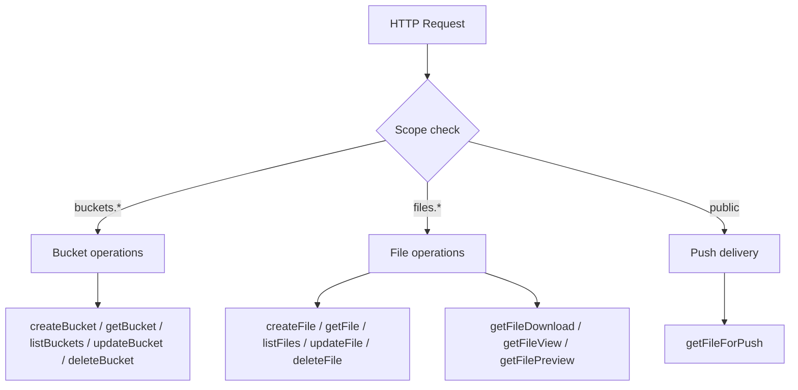
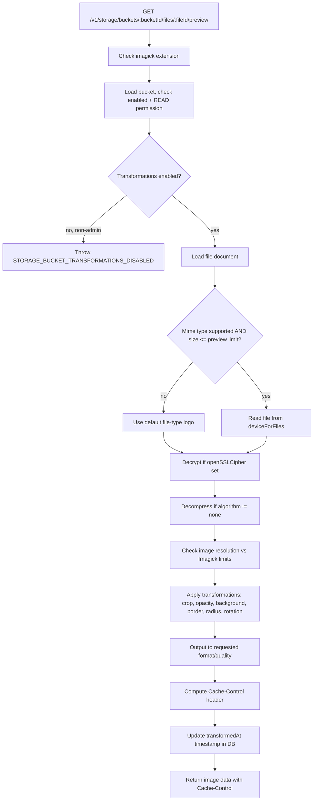

# Storage — Flow Diagram

> Generated by Reversa Archaeologist · 2026-08-04

## Main request flow



## Sub-flow 1: Create bucket

```mermaid
flowchart TD
    A[POST /v1/storage/buckets] --> B[Validate params: name, permissions, limits]
    B --> C[Aggregate permissions]
    C --> D[createDocument in 'buckets' collection]
    D --> E[createCollection 'bucket_{sequence}' with files schema]
    E --> F{Duplicate?}
    F -->|yes| G[Throw STORAGE_BUCKET_ALREADY_EXISTS]
    F -->|no| H[Queue buckets event]
    H --> I[Return 201 Bucket model]
```

## Sub-flow 2: Chunked file upload

```mermaid
flowchart TD
    A[POST /v1/storage/buckets/:bucketId/files] --> B[Load bucket, check enabled + CREATE permission]
    B --> C[Validate file extension against allowedFileExtensions]
    C --> D[Validate file size against maximumFileSize]
    D --> E{Content-Range header?}
    E -->|yes, chunked| F[Acquire distributed lock on fileId]
    E -->|no, single| F
    F --> G[Prepare upload path on deviceForFiles]
    G --> H[Upload chunk to deviceForFiles]
    H --> I{All chunks uploaded?}
    I -->|no| J[Update chunksUploaded in DB]
    J --> K[Return 201 partial file doc]
    I -->|yes| L[Finalize: merge metadata]
    L --> M{Antivirus enabled AND file <= limit?}
    M -->|yes| N[ClamAV scan]
    N -->|infected| O[Delete file, throw STORAGE_INVALID_FILE]
    N -->|clean| P[Continue]
    M -->|no| P
    P --> Q{Compression enabled AND file <= buffer?}
    Q -->|yes| R[GZIP or ZSTD compress data]
    Q -->|no| S[Skip compression]
    R --> T{Encryption enabled AND file <= buffer?}
    S --> T
    T -->|yes| U[AES-128-GCM encrypt data]
    T -->|no| V[Write as-is]
    U --> W[Write encrypted+compressed data to deviceForFiles]
    V --> W
    W --> X[createDocument / updateDocument in 'bucket_{sequence}']
    X --> Y[Queue files event]
    Y --> Z[Return 201 File model]
```

## Sub-flow 3: File preview (image transformation)


