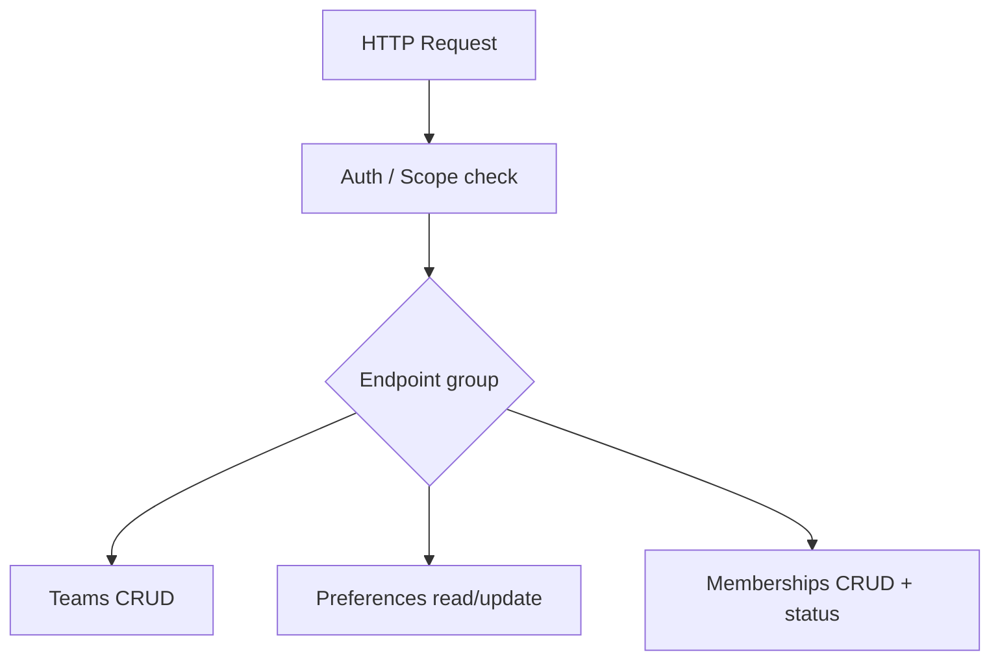
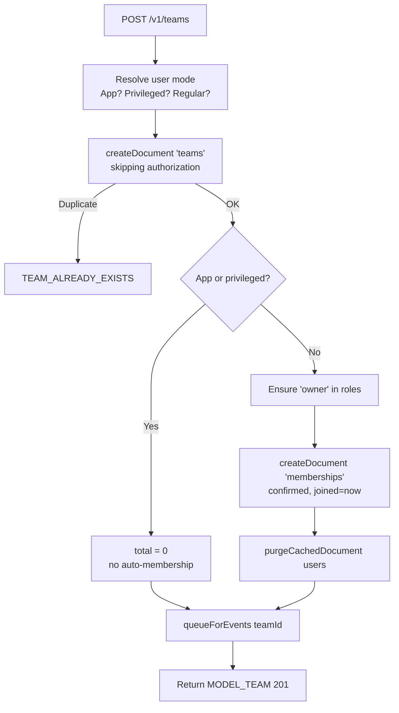
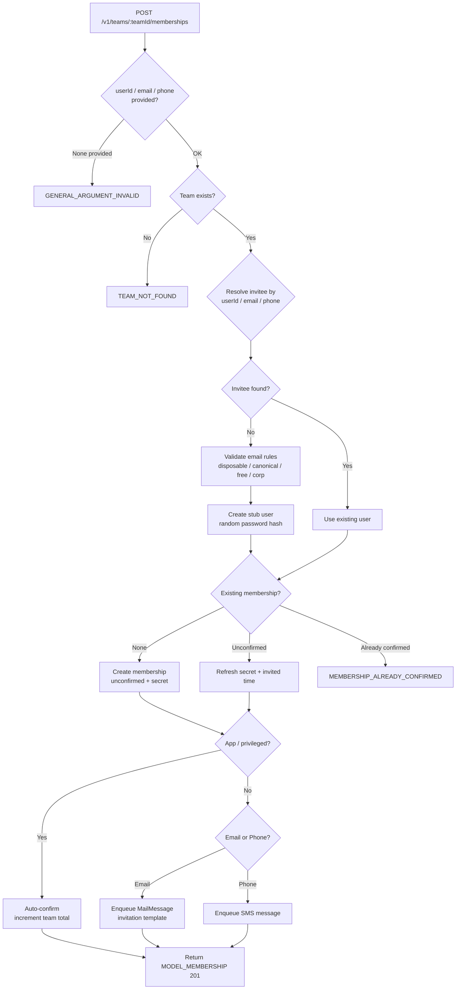
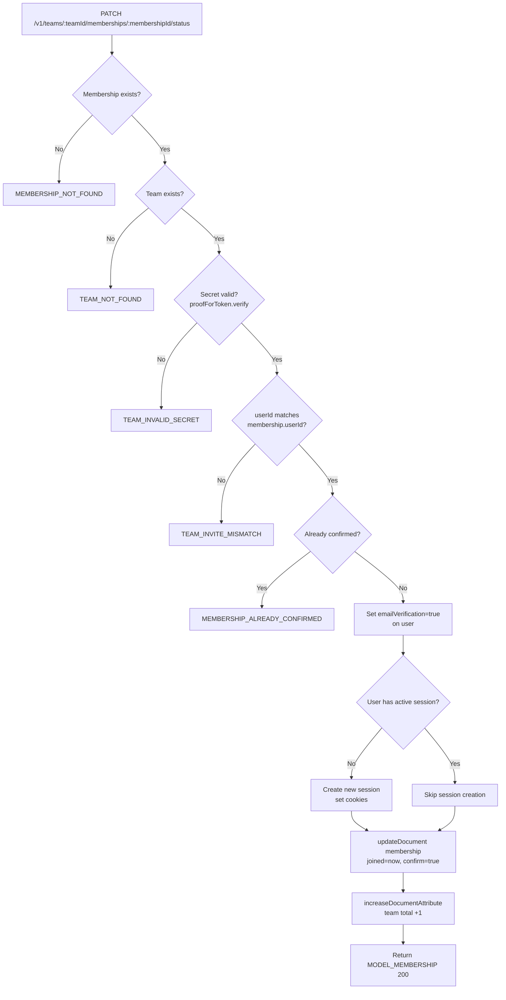
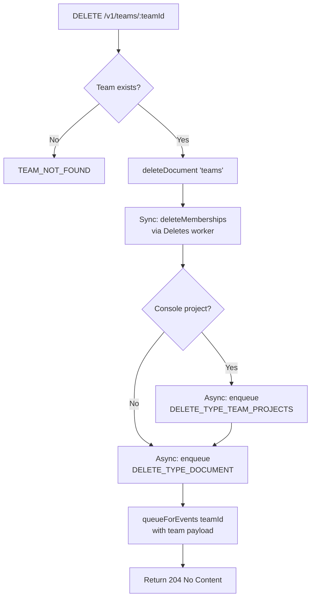

# Teams — Flow Diagram

> Generated by Reversa Archaeologist · 2026-08-04

## Main request flow

## Sub-flows (key operations)

### 1. Create Team

### 2. Create Team Membership (invite flow)

### 3. Confirm Membership Status (invite acceptance)

### 4. Delete Team

