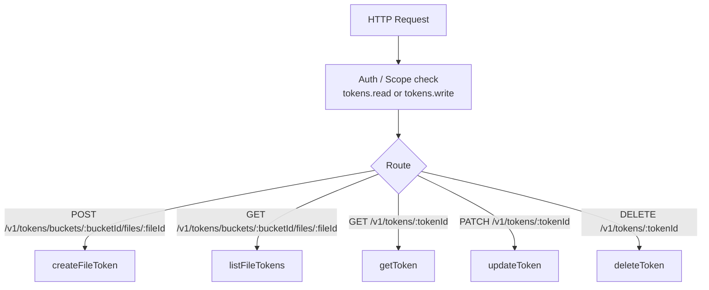
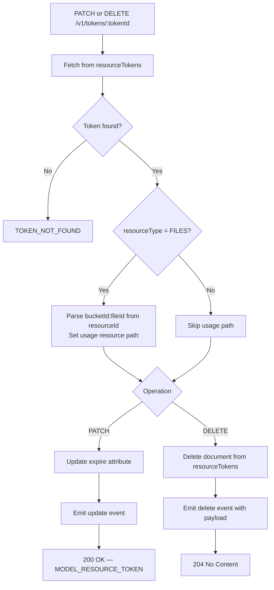

# Tokens — Flow Diagram

> Generated by Reversa Archaeologist · 2026-08-04

## Main request flow



## Sub-flows (key operations)

### Create file token

```mermaid
flowchart TD
    A[POST /v1/tokens/buckets/:bucketId/files/:fileId] --> B[getFileAndBucket helper]
    B --> C{Bucket exists & enabled?}
    C -->|No| ERR1[STORAGE_BUCKET_NOT_FOUND]
    C -->|Yes| D{Caller has READ on bucket?}
    D -->|No| ERR2[USER_UNAUTHORIZED]
    D -->|Yes| E{fileSecurity enabled?}
    E -->|Yes| F{Caller has UPDATE on bucket OR file?}
    E -->|No| G{Caller has UPDATE on bucket?}
    F -->|No| ERR3[USER_UNAUTHORIZED]
    F -->|Yes| H[Create resourceTokens document]
    G -->|No| ERR3
    G -->|Yes| H
    H --> I[128-byte random secret generated]
    I --> J[Store token with encrypted secret]
    J --> K[Emit tokens.\[tokenId\].create event]
    K --> L[201 Created — MODEL_RESOURCE_TOKEN]
```

### Update / Delete token


