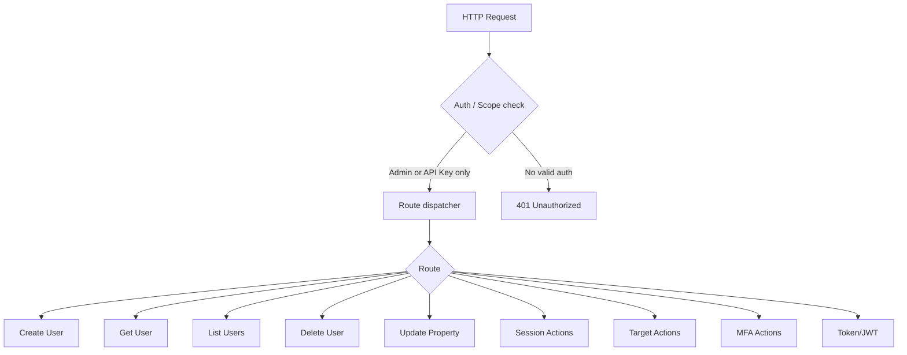
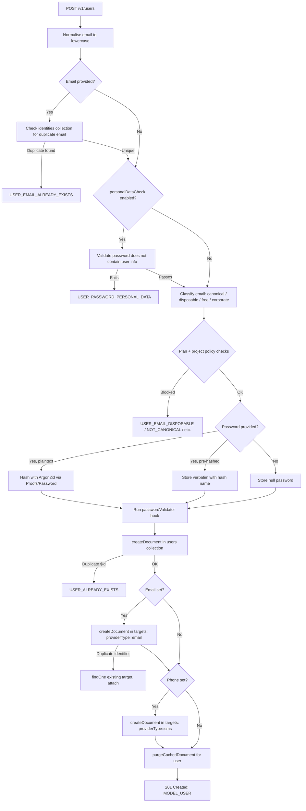
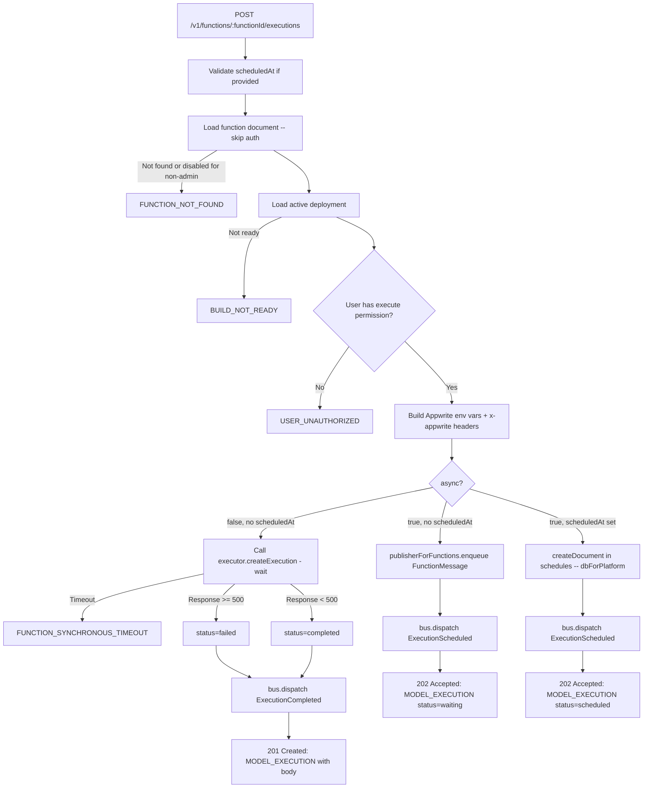

# Users — Flow Diagram

> Generated by Reversa Archaeologist · 2026-08-04

## Main request flow



## Sub-flow: Create User (all password variants share this)



## Sub-flow: Create Admin Session

```mermaid
flowchart TD
    A[POST /v1/users/:userId/sessions] --> B[getDocument users/:userId]
    B -- Not found --> ERR[USER_NOT_FOUND]
    B -- Found --> C[Generate token secret via proofForToken]
    C --> D[Detect OS, browser, device from User-Agent]
    D --> E[Lookup country from IP via geoRecord]
    E --> F[Build session document: provider=server, factors=[server]]
    F --> G[createDocument in sessions]
    G --> H[purgeCachedDocument user]
    H --> I[Encode userId + secret into Store]
    I --> J[Attach countryName and encoded secret to session]
    J --> K[Emit users.[userId].sessions.[sessionId].create]
    K --> L[201 Created: MODEL_SESSION]
```

## Sub-flow: Create Execution (synchronous vs. asynchronous)


