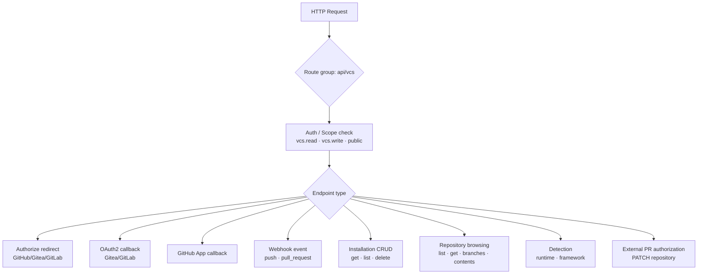
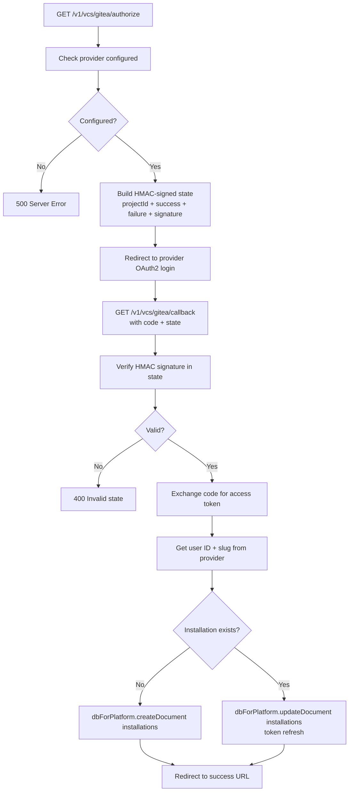
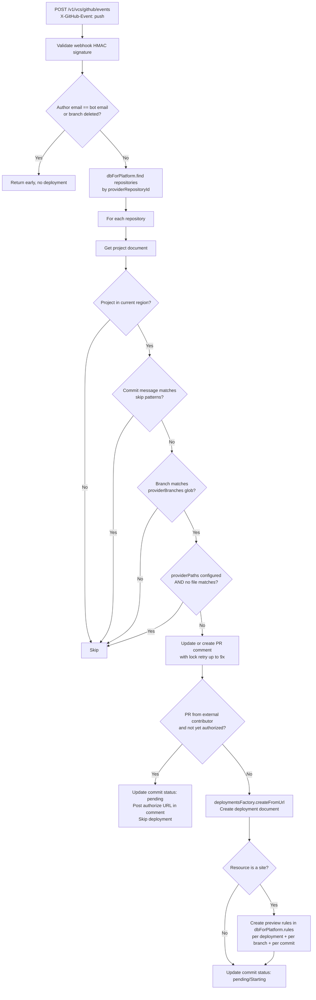
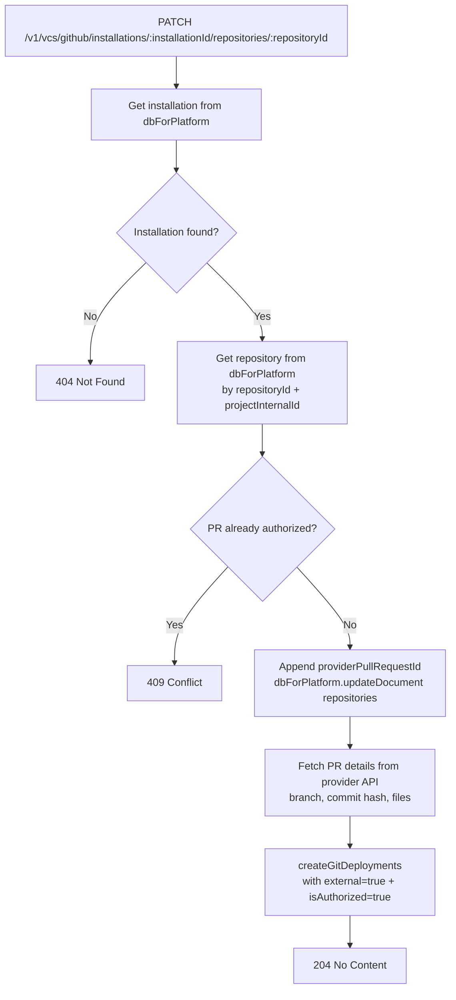

# VCS — Flow Diagram

> Generated by Reversa Archaeologist · 2026-08-04

## Main request flow

## Sub-flows

### 1. Installation via OAuth2 (Gitea / GitLab)

### 2. GitHub webhook push event (core deployment fan-out)

### 3. External PR contributor authorization

