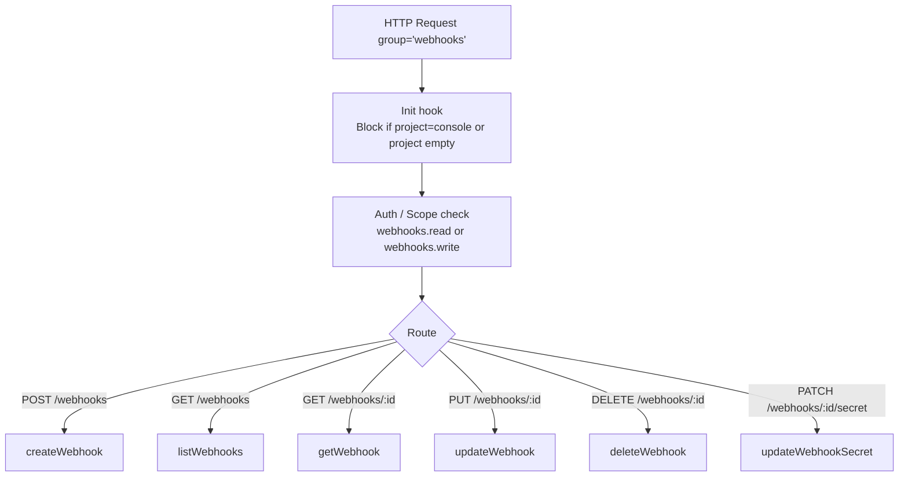
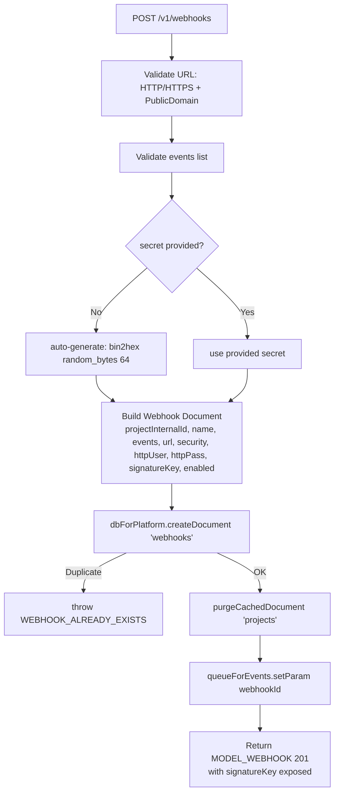
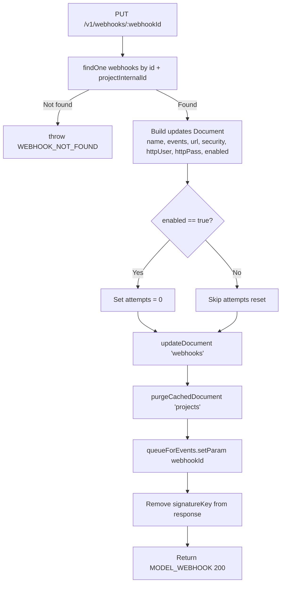
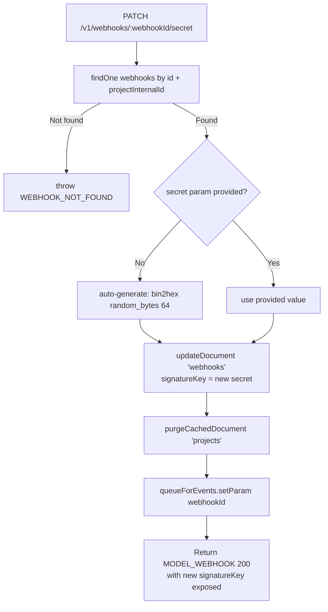

# Webhooks — Flow Diagram

> Generated by Reversa Archaeologist · 2026-08-04

## Main request flow

## Sub-flows (key operations)

### Webhook creation

### Webhook update (re-enable resets attempts)

### Secret rotation

