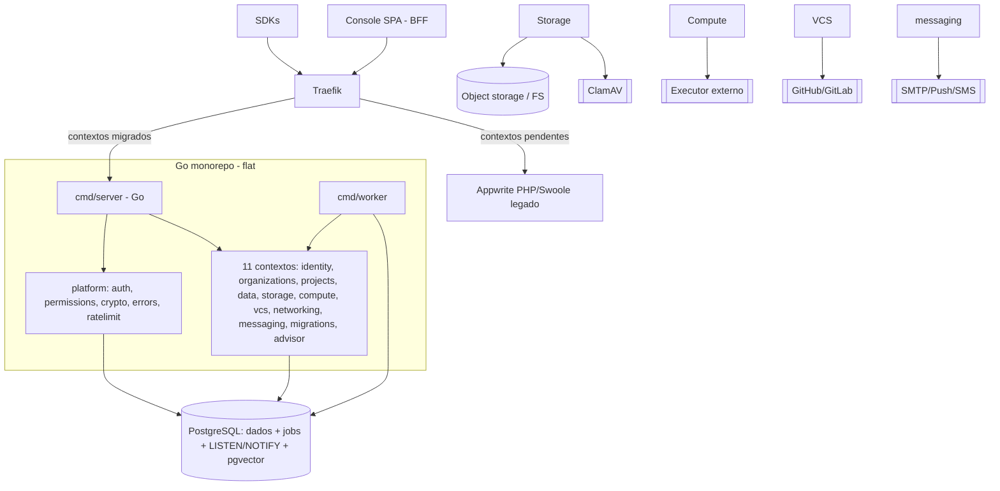

# Target Architecture — gowrite (revised post red-team)

## Visão geral
Sistema Go em monorepo **flat/idiomático** (sem hexagonal ports/adapters — red-team O1), **11 bounded contexts** + Console BFF + `platform/` de leaf packages. Persistência **única em PostgreSQL** (relacional + JSONB + pgvector); **sem Redis** (O3) — fila via `jobs` table + `SELECT … FOR UPDATE SKIP LOCKED`, realtime via `LISTEN/NOTIFY`, rate-limit via token-bucket in-memory por instância. Acesso a dados via **`sqlc`** (SQL tipado gerado) — não uma engine genérica (O4). Um binário `server` (HTTP) + `worker` (consumer de `jobs`). Serviços externos (executor, browser, assistant, ClamAV, VCS/OAuth/SMTP) preservados como dependências de rede (fase 1). Strangler: Traefik roteia por **contexto** (não módulo).

## Diagrama de componentes



## Componentes
| Componente | Tipo | Papel |
|-----------|------|-------|
| `cmd/server` | API | entrada HTTP; middleware auth/abuse/erro; roteia p/ os contextos |
| `cmd/worker` | Worker | consome `jobs` (Postgres, `SKIP LOCKED`): builds, deletes, messaging, certificates, migrations |
| `platform/` | Leaf packages | `errors` (`AppError`), `auth`, `permissions` (`roles.php`), `crypto` (25 campos AES-GCM), `ratelimit` (token-bucket). **Sem** camada db/queue abstrata — contextos usam `pgx`/`sqlc` direto |
| 11 contextos `internal/*` | Serviço | struct concreto + funções; sem `ports/adapters` |
| Console | BFF | compõe Identity+Orgs+Projects; delega, não possui aggregate |
| PostgreSQL | DB + fila + bus | fonte única (substitui Mongo+MariaDB+Postgres **e** Redis) |
| Traefik | Gateway | roteamento Strangler por contexto |

## Bounded contexts
Ver `specs/tech-architecture/tech-stack.md` (mapa revisado, 11 contextos + BFF): Identity, Organizations, Projects(+Webhooks), Data, Storage, Compute, VCS, Networking, Messaging, Migrations, Advisor. Console = BFF.

## Honra ao paradigma escolhido (transformacional / Go-native, lean)
| Implicação (`paradigm_decision.md`) | Materialização (revisada) |
|---|---|
| 1 — Exceções → erros explícitos | `platform/errors.AppError{Code, HTTPStatus, Err}`; `(v, error)`; middleware traduz |
| 2 — Container DI → wiring explícito | composição no `cmd/server/main.go`; **structs concretas**, sem container e sem `ports/` (O1) |
| 3 — Herança `Action` → interface | uma interface `http.Handler` mínima no edge; corpo dos handlers = funções concretas |
| 4 — Corrotinas Swoole → goroutines | `cmd/worker` pool de goroutines sobre `jobs`+`SKIP LOCKED`; `errgroup`; ADR-008 (estado terminal) preservado |
| 5 — Config PHP dinâmica → tipos estáticos | structs Go + `sqlc` (SQL tipado) + migrations Postgres; **sem engine genérica** (O4) |

## Honra à topologia escolhida (Híbrido, 11 contextos + BFF, flat)
```
cmd/{server,worker}/
internal/
  identity/ organizations/ projects/ data/ storage/
  compute/  vcs/           networking/ messaging/ migrations/ advisor/
    # flat: service.go, <entity>.go, queries.sql (sqlc), *_test.go (Postgres efêmero)
  console/       # BFF: compõe os contextos acima
platform/
  errors/ auth/ permissions/ crypto/ ratelimit/   # leaf packages, deps mínimas
  ops/           # health, avatars, presences (stateless — só estes)
db/              # sqlc gerado + migrations/*.sql
pkg/
```

## Decisões arquiteturais (rastreabilidade)
| Decisão | Origem | ADR sugerido |
|---|---|---|
| Postgres único, **sem Redis** (jobs+SKIP LOCKED, LISTEN/NOTIFY) | BR-HUMANA-002 + red-team O3/O5 | sim |
| `sqlc` + SQL escrito à mão; **sem engine utopia-php reimplementada** | BR-HUMANA-001 + red-team O4 | sim |
| Pacotes flat, sem hexagonal ports/adapters | red-team O1 | sim |
| `platform/` = leaf packages, não framework | red-team O2 | sim |
| 11 contextos + Console BFF; flip por contexto; ordem topológica | red-team B/S | sim |
| Strangler via Traefik por contexto | `migration_strategy.md` | não |
