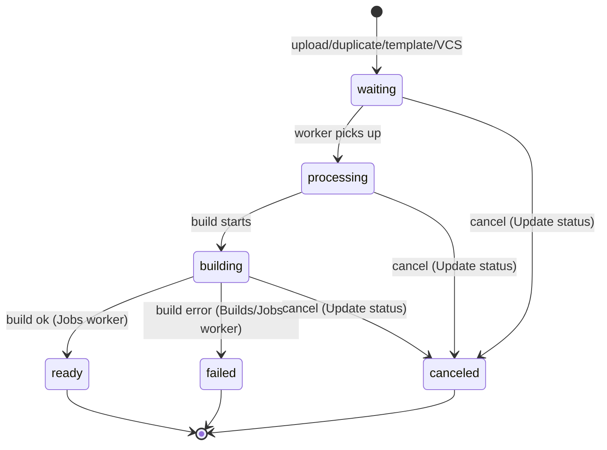
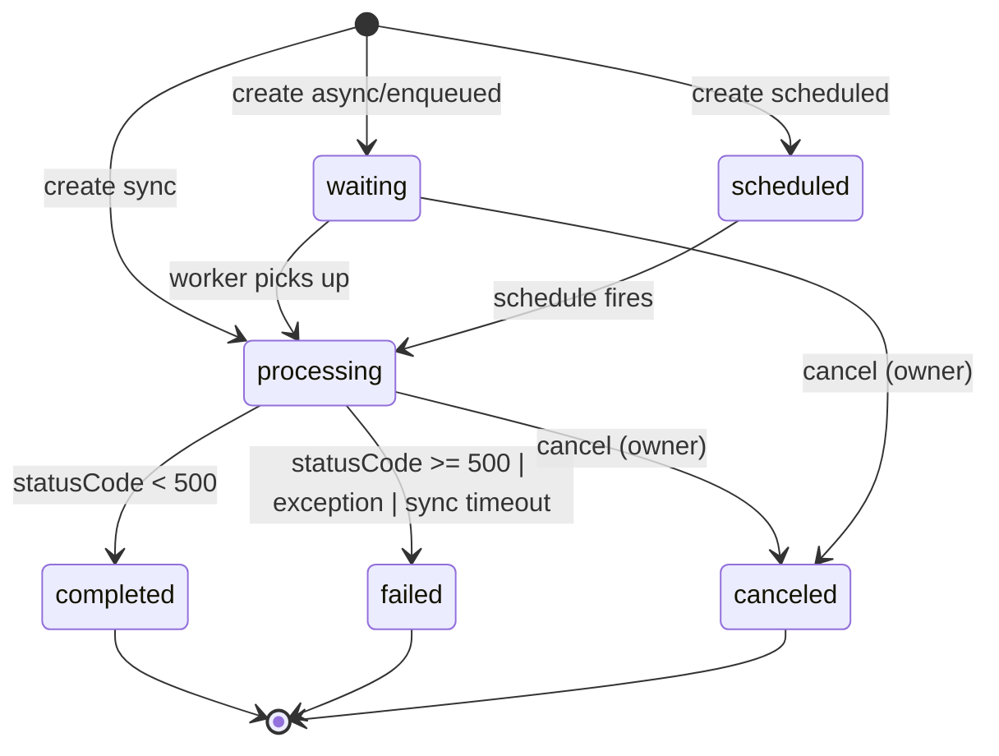
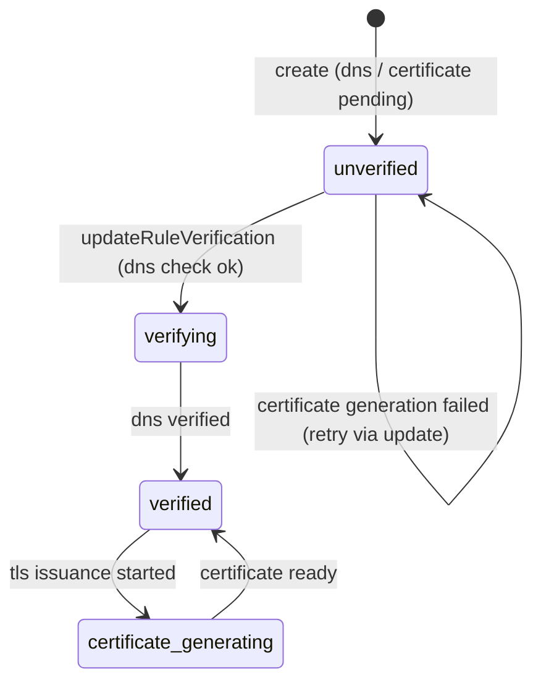
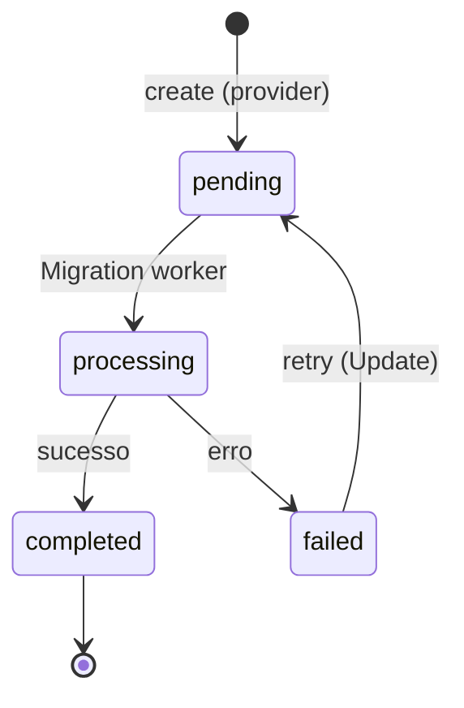
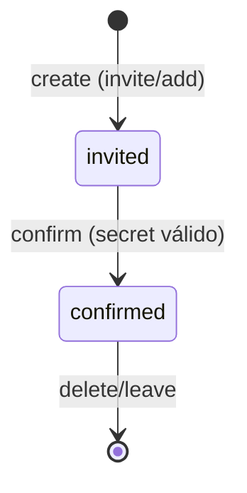
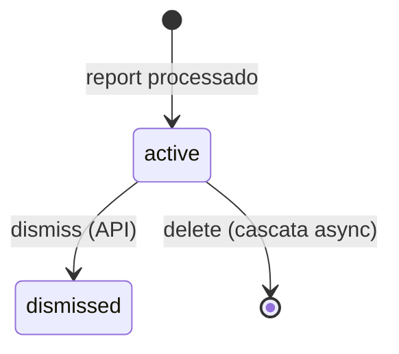
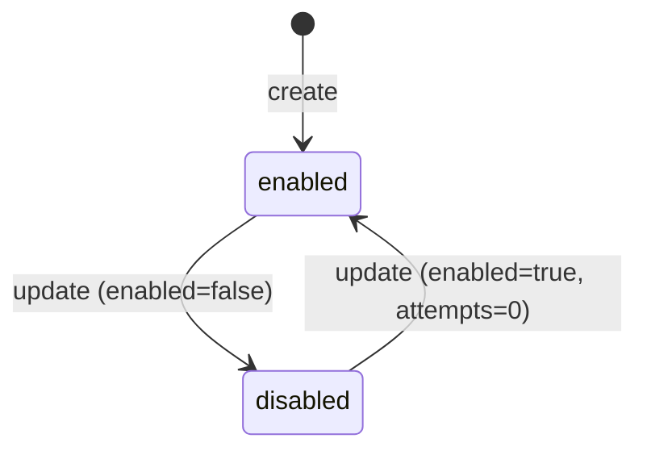
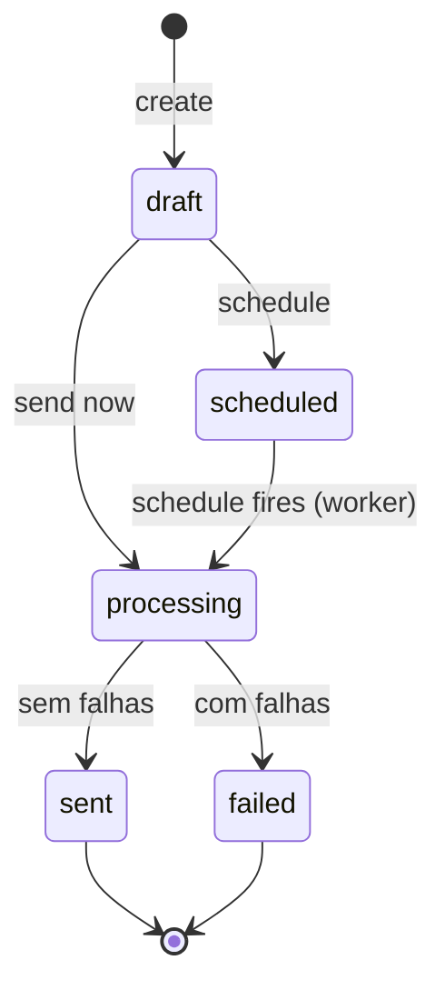

# State Machines — Appwrite

> Generated by the **Detective** agent on 2026-08-05.
> Máquinas de estado extraídas dos mappings do Archaeologist + confirmação direta no código (status literais e exceções `BUILD_*`).
> Confiança: 🟢 CONFIRMADO · 🟡 INFERIDO · 🔴 LACUNA

## 1. Deployment (functions/sites)

Estados reais (literais no código): `waiting` → `processing` → `building` → `ready` | `failed` | `canceled`. Regras:
- 🟢 `ready` é pré-condição para executions e ativação de deployment (`BUILD_NOT_READY`).
- 🟢 Cancelamento bloqueado quando `ready`/`failed` (`BUILD_ALREADY_COMPLETED`).
- 🟢 Transições finais gravadas pelo **Jobs worker** (`$success ? 'ready' : 'failed'`); Builds worker marca `failed` em erro de build (`Functions/Workers/Builds.php:450`).
- 🟢 `canceled` **é** estado persistido — confirmado em `Functions/Http/Deployments/Status/Update.php:154` e `Sites/Http/Deployments/Status/Update.php:152` (`'status' => 'canceled'`). *[Revisão: era 🟡, upgrade para 🟢.]*

> ⚠️ **[Revisão]** A versão anterior omitia os estados de enfileiramento `waiting` e `processing` que precedem `building` (literais confirmados no código). Diagrama corrigido.

## 2. Execution (functions)

Estados reais (literais no código): `waiting` · `processing` · `scheduled` → `completed` | `failed` | `canceled`. Regras:
- 🟢 Sync: status derivado do HTTP statusCode da função (≥500 → `failed`, senão `completed`) — `Functions/Http/Executions/Create.php:476`.
- 🟢 Exceção durante execução força `status = 'failed'` (`Create.php:488`); timeout síncrono lança `FUNCTION_SYNCHRONOUS_TIMEOUT` e também persiste como `failed` — **não existe status persistido `timeout`**.
- 🟢 Cancelamento de execution agendada valida **ownership** (fix: `executions-ownership-test`) e persiste `canceled` (uma L).
- 🟢 Executions agendadas começam em `scheduled`; assíncronas/enfileiradas em `waiting` → `processing`.

> ⚠️ **[Revisão]** A versão anterior desta spec usava o estado `running` e um estado `timeout`/`cancelled` — ambos **incorretos**. O código não usa o literal `running` (usa `processing`), grafa `canceled` com uma L, e não persiste `timeout` (mapeia para `failed`). Diagrama corrigido abaixo. Evidência: `grep "'status' => '...'"` → `waiting`, `processing`, `completed`, `failed`, `canceled`, `scheduled`.

## 3. Rule (Proxy — domínio customizado)

Estados: `unverified` → `verifying` → `verified` → `certificate_generating`. Regras:
- 🟢 Status legado `created` é **renomeado para `unverified`** na leitura (Get/XList) — compatibilidade.
- 🟢 Re-verificação bloqueada quando `verified`/`certificate_generating` (cert já emitido/emitindo).
- 🟢 `unverified` também cobre **falha de geração de certificado** (fica como está).
- 🟢 Domínios de propriedade da Appwrite entram direto como `verified`.

## 4. Migration (providers/CSV/JSON)

Estados: `pending` → `processing` → `completed` | `failed`. Regras:
- 🟢 Todos os providers criam com `pending`.
- 🟢 Retry **apenas** quando `failed` (Update lança se `status !== 'failed'`).
- 🟢 Transição para `processing` ocorre no worker de migração.

## 5. Membership (teams)

Status **derivado** dos timestamps `invited`/`joined` (não é campo). Regras:
- 🟢 `invited` → `confirmed` ao confirmar o invite (valida `proofForToken`).
- 🟢 Roles: string arbitrária; deve existir ≥1 `owner` (`MEMBERSHIP_DOWNGRADE_PROHIBITED`).

## 6. Insight (Advisor)

Status: `active` → `dismissed`. 🟢/🟡 (dos mappings; confirmar escrita no código).

## 7. Webhook

Toggle `enabled` ↔ `disabled`. 🟢 Re-enable reseta `attempts`.

## 7b. Message (messaging worker) — 🟢 resolvido na revisão

Estados (🟢 `src/Appwrite/Messaging/Status.php`): `draft` · `scheduled` · `processing` → `sent` | `failed`.
- 🟢 `draft` — mensagem ainda não pronta para envio.
- 🟢 `scheduled` — agendada para envio futuro.
- 🟢 `processing` — capturada pelo worker, enviando (`Workers/Messaging.php`).
- 🟢 `sent` — enviada sem erros; `failed` — enviada com algum erro (`Messaging.php:303` → `$hasFailures ? FAILED : SENT`).
- 🟢 Terminais `sent`/`failed` são idempotentes: o worker pula se o status já é SENT/FAILED (`Messaging.php:155`) — coerente com a regra transversal de "estado terminal obrigatório" (§8, ADR-008).

## 8. Regras transversais de estado

- 🟢 **Estado terminal obrigatório para jobs de fila** — fix de messaging: "stop messages getting stranded in processing" / "keep a terminal status when cleanup fails". Design geral dos workers: cada mensagem termina em estado terminal.
- 🟢 Executions/deployments nunca dependem de estado intermediário para ações destrutivas (cancel guard).
- 🟢 **User status é booleano**, não um enum `0/1/2`: `true` = ativo, `false` = bloqueado. Endpoint `PATCH /v1/users/:userId/status`, param `new Boolean(true)` e `updateDocument('users', ..., ['status' => (bool) $status])` — `Users/Http/Users/Status/Update.php:53,68`. *[Revisão: a lacuna 🔴 anterior hipotetizava "(0/1/2)", o que é **incorreto**; resolvido para 🟢 booleano.]*

## Lacunas 🔴

- ~~Persistência exata do estado `canceled` em deployments.~~ ✅ Resolvido na revisão (confirmado, `Deployments/Status/Update.php:154`).
- ~~Origem de `timeout`/`cancelled` em executions.~~ ✅ Resolvido: não há status persistido `timeout` (mapeia para `failed`); cancel persiste `canceled`.
- ~~User status (0/1/2).~~ ✅ Resolvido: booleano (`true`=ativo, `false`=bloqueado).
- ~~Mapa de transições do worker de messaging.~~ ✅ Resolvido na revisão — ver §7b (`Messaging/Status.php`).
